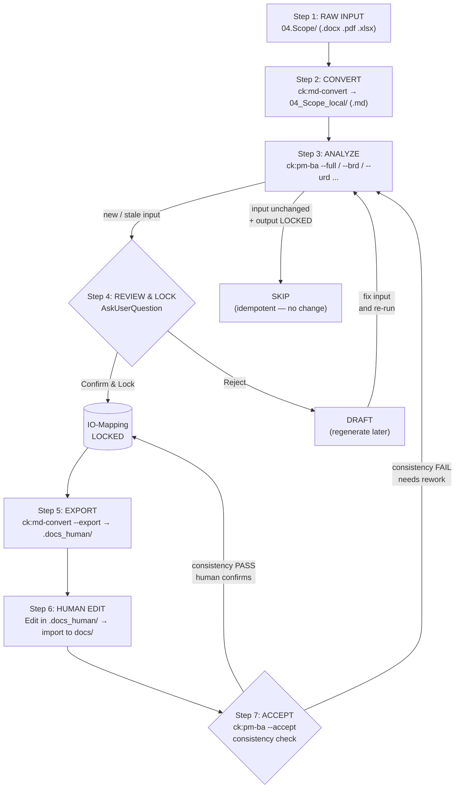

# PM-BA Workflow: 7-Step Bidirectional Pipeline

**Version:** 1.0  
**Status:** Active  
**Last Updated:** 2026-05-19  
**Applies to:** Tất cả pm-ba skill modes

---

## Purpose

Document này mô tả **7-step bidirectional pipeline** của hệ thống PM-BA phân tích tài liệu dự án <Project>. Pipeline đảm bảo:

- **Truy vết đầy đủ**: mọi output đều có input source được ghi nhận
- **Bảo vệ công sức**: output đã được human review không bị ghi đè vô tình
- **Luồng hai chiều**: human có thể chỉnh sửa output và đưa lại vào hệ thống
- **Cấu hình tập trung**: tất cả đường dẫn được quản lý qua `pm-ba.config.json`

Pipeline này là rule **bắt buộc** — mọi pm-ba mode đều phải tuân thủ. Xem chi tiết cơ chế IO-Mapping tại `references/io-mapping-protocol.md`.

---

## Kiến trúc Tổng quan

```
[RAW INPUT]          [CONVERT]          [ANALYZE]
04.Scope/       →  04_Scope_local/  →  PM_PhanTich/docs/
  .docx/.xlsx         .md only              ba-*.md
  .pdf/.pptx        (subfoldered)           pm-*.md
      │                   │                    │
      │                   │          [IO-MAPPING LOCK]
      │                   │          docs/.pm-ba/io-mapping.json
      │                   │                    │
      │              [EXPORT]             [HUMAN EDIT]
      │           .docs_human/    ←    docs/ → .docs_human/
      │              .docx/.pdf              edits
      │                   │                    │
      └───────────────────┴──────[ACCEPT]──────┘
                                  --accept
                               consistency check
                                  re-LOCK
```

---

## The 7 Steps

### Step 1: RAW INPUT — Human đặt file nguồn

**Thư mục:** `10.[PROJECT]\04.Scope\` (ngoài project root)

Human đặt các tài liệu nguồn (BRD, URD, hợp đồng, biên bản họp, v.v.) vào thư mục này. Các định dạng được hỗ trợ:

| Loại tài liệu | Định dạng phổ biến | Thư mục con |
|--------------|-------------------|-------------|
| BRD (Business Requirements) | `.docx`, `.pdf` | `04.Scope/brd/` |
| URD (User Requirements) | `.docx`, `.pdf` | `04.Scope/urd/` |
| Hợp đồng | `.docx`, `.pdf` | `04.Scope/contract/` |
| Biên bản họp | `.docx`, `.xlsx` | `04.Scope/meeting/` |
| Sơ đồ quy trình | `.vsdx`, `.drawio` | `04.Scope/process-flow/` |
| Đặc tả màn hình | `.docx`, `.pptx` | `04.Scope/screen-spec/` |

**Lưu ý:** pm-ba **không đọc trực tiếp** từ thư mục này. Step 2 thực hiện convert trước.

---

### Step 2: CONVERT — Chuyển đổi sang Markdown

**Lệnh:** `ck:md-convert`  
**Source:** `10.[PROJECT]\04.Scope\`  
**Destination:** `100_Local\04_Scope_local\` (`config.input_root`)

Human hoặc automation chạy:
```
/md-convert 10.[PROJECT]/04.Scope/ --output 100_Local/04_Scope_local/
```

Kết quả: mỗi file nguồn được convert thành `.md`, giữ nguyên cấu trúc subfolder:
```
04_Scope_local/
├── brd/
│   └── BRD_QL_Sau_Vay_v1.md
├── urd/
│   └── URD_Module_Giai_Ngan.md
├── contract/
│   └── HopDong_[CLIENT]_v2.md
├── meeting/
│   └── BienBan_Hop_20260515.md
├── process-flow/
│   └── LuongXuLy_GiaiNgan.md
└── screen-spec/
    └── ManHinh_KhachHang.md
```

**Invariant:** `config.input_root` luôn trỏ đến thư mục này. pm-ba chỉ đọc `.md` files từ đây.

---

### Step 3: ANALYZE — pm-ba phân tích và sinh output

**Lệnh:** `ck:pm-ba --full` hoặc các mode riêng lẻ  
**Input:** `config.input_root` (= `04_Scope_local/`)  
**Output:** `config.output_root` (= `PM_PhanTich/docs/`)

**Chạy toàn bộ pipeline:**
```
ck:pm-ba --full
```
Thực thi theo dependency wave (xem `references/io-mapping-protocol.md` §6):
- Wave A: `--contract`, `--brd` (song song)
- Wave B: `--urd`, `--process-map`, `--screen`, `--meeting-post` (song song sau A)
- Wave C: `--trace` (sau B)

**Chạy mode riêng lẻ:**
```
ck:pm-ba --brd      # Phân tích BRD
ck:pm-ba --urd      # Phân tích URD
ck:pm-ba --screen   # Phân tích đặc tả màn hình
```

**Trong quá trình chạy, pm-ba:**
1. Tính SHA-256 của input (normalize-hash.cjs)
2. Kiểm tra idempotency: nếu input không đổi và output LOCKED → skip
3. Sinh output files ra `docs/`
4. Tạo/cập nhật entry trong `docs/.pm-ba/io-mapping.json` với status `DRAFT`
5. Chuyển sang Step 4 (review prompt)

---

### Step 4: REVIEW & LOCK — Human xác nhận và khóa

**Trigger:** pm-ba gọi `AskUserQuestion` sau khi sinh output  
**Cập nhật:** `docs/.pm-ba/io-mapping.json` → status `LOCKED`

Sau khi sinh output, pm-ba hiển thị prompt:

```
Header: "IO-Mapping: Review & Lock Output?"
Question: "Output cho [input_file] đã được sinh (vN).

Files được tạo:
  ✓ docs/ba-brd-analysis.md
  ✓ docs/pm-traceability-matrix.md

Bạn có muốn Lock các files này?"

Options:
  → "Confirm & Lock"    — LOCKED, hook bảo vệ từ đây
  → "Review trước"      — PENDING_REVIEW, xem output trước
  → "Reject / Tái sinh" — DRAFT, sẽ tái sinh khi cần
```

**Khi LOCKED:**
- `locked_at`, `locked_by = "human"` được ghi
- Snapshot được tạo
- Audit log ghi event `LOCK`
- Hook `pre-write-io-mapping-check.cjs` bắt đầu bảo vệ file

**Kiểm tra trạng thái IO-Mapping:**
```
ck:pm-ba --io-status    # Xem trạng thái tất cả mappings
```

---

### Step 5: EXPORT — Xuất cho human đọc/chỉnh sửa

**Lệnh:** `ck:md-convert --export`  
**Source:** `config.output_root` (= `docs/`)  
**Destination:** `config.human_export_root` (= `.docs_human/`)

Human chạy khi muốn xuất sang định dạng có thể đọc/edit ngoài hệ thống:
```
/md-convert docs/ --export --output .docs_human/ --format docx
```

Kết quả: các `.md` trong `docs/` được convert sang `.docx` (hoặc `.pdf`) trong `.docs_human/`.

**Quan trọng:**
- `.docs_human/` là **export-only** — pm-ba KHÔNG đọc từ đây
- Human có thể tự do chỉnh sửa files trong `.docs_human/`
- Để đưa chỉnh sửa lại vào hệ thống → Step 6 + Step 7

---

### Step 6: HUMAN EDIT — Chỉnh sửa và import lại

**Source:** `.docs_human/` (human chỉnh sửa trực tiếp)  
**Destination:** `docs/` (sau khi import)

Human thực hiện chỉnh sửa trong `.docs_human/`, sau đó convert ngược lại:
```
/md-convert .docs_human/ --output docs/ --overwrite
```

**Lưu ý về LOCK protection:**
- Nếu file đích trong `docs/` đang LOCKED → hook sẽ chặn việc ghi đè
- Để import thành công, phải chạy `--accept` (Step 7) thay vì import trực tiếp
- Khuyến nghị workflow: import → pm-ba detect STALE_OUTPUT → --accept flow

**Thay thế:** Human có thể chỉnh sửa trực tiếp file `.md` trong `docs/`. Hook sẽ chặn nếu file LOCKED. Dùng `--accept` để xử lý.

---

### Step 7: ACCEPT — Kiểm tra nhất quán và re-lock

**Lệnh:** `ck:pm-ba --accept`  
**Trigger:** Sau khi human edit output files (dù qua .docs_human hay trực tiếp)

```
ck:pm-ba --accept
```

**Quá trình thực thi:**

1. **Scan**: Phát hiện tất cả output files trong `docs/` có hash khác với io-mapping
2. **Consistency check**: Spawn subagent kiểm tra tính nhất quán với input gốc
3. **Report**: Sinh `plans/reports/consistency-check-{date}-{map_id}.md` per mapping
4. **AskUserQuestion**: Trình bày kết quả và hỏi confirm re-lock

```
"MAP-001 (ba-brd-analysis.md) — Thay đổi phát hiện:
  Input: brd/BRD_QL_Sau_Vay_v1.md (không đổi)
  Output: hash thay đổi (def456 → xyz789)
  Consistency: PASS (xem plans/reports/consistency-check-260519-map-001.md)
  
Xác nhận re-lock với version mới?"
```

5. **Re-lock**: Tạo version mới trong `versions[]`, set `SUPERSEDED` cho version cũ
6. **Audit**: Ghi event `SUPERSEDE`, `LOCK` vào audit.log

Sau Step 7, pipeline quay lại trạng thái ổn định — tất cả outputs đều LOCKED.

---

## Critical Invariants

### INV-1: `docs/` là canonical source

`docs/` là thư mục canonical duy nhất cho tất cả pm-ba outputs. Đây là nơi:
- pm-ba đọc và ghi
- io-mapping theo dõi
- Hook bảo vệ

`.docs_human/` chỉ là export cho human convenience — **không bao giờ** là nguồn sự thật.

### INV-2: `.docs_human/` là read-only với pm-ba

pm-ba **không bao giờ** đọc files từ `.docs_human/` làm input phân tích. Nếu human muốn cập nhật phân tích dựa trên chỉnh sửa, phải import ngược vào `docs/` trước (Step 6), sau đó chạy `--accept` (Step 7).

### INV-3: LOCKED outputs được bảo vệ hai tầng

Mọi file LOCKED trong `docs/` được bảo vệ bởi:
1. Hook `pre-write-io-mapping-check.cjs` (tool-level block)
2. Invariant 20 trong SKILL.md (AI-level enforcement)

Không có cách nào bypass ngoài `--unlock <map_id>` hoặc `--accept` (xem `references/io-mapping-protocol.md` §8).

### INV-4: Tất cả paths qua `pm-ba.config.json`

Không có hardcoded paths trong bất kỳ script hay mode nào. Tất cả đường dẫn đọc từ:

```
.claude/pm-ba.config.json → {
  input_root    → 04_Scope_local/
  output_root   → PM_PhanTich/docs/
  human_export_root → PM_PhanTich/.docs_human/
  io_mapping.store_path → docs/.pm-ba/io-mapping.json
}
```

Khi project được di chuyển hoặc paths thay đổi, chỉ cần cập nhật `pm-ba.config.json`.

### INV-5: Atomic writes cho io-mapping.json

Mọi cập nhật `io-mapping.json` phải dùng atomic write pattern:
```javascript
// write to tmp → fsync → rename (không bao giờ ghi trực tiếp)
fs.writeFileSync(tmpPath, JSON.stringify(data, null, 2));
fs.renameSync(tmpPath, finalPath);
```

Tránh corrupt file khi process bị kill giữa chừng.

---

## Mermaid Diagram: Pipeline 7 Bước



---

## Lệnh nhanh (Quick Reference)

| Tình huống | Lệnh |
|-----------|------|
| Chạy toàn bộ pipeline | `ck:pm-ba --full` |
| Phân tích BRD mới | `ck:pm-ba --brd` |
| Phân tích URD | `ck:pm-ba --urd` |
| Xem trạng thái tất cả mappings | `ck:pm-ba --io-status` |
| Nhận lại human edits | `ck:pm-ba --accept` |
| Unlock một mapping | `ck:pm-ba --unlock MAP-001` |
| Validate io-mapping.json | `node .claude/skills/pm-ba/scripts/io-mapping-validator.cjs` |
| Repair nếu corrupt | `node .claude/skills/pm-ba/scripts/io-mapping-validator.cjs --fix` |
| Migrate existing docs/ | `node .claude/skills/pm-ba/scripts/io-mapping-migrate.cjs --dry-run` |

---

## Cross-References

| Tài liệu | Nội dung |
|---------|---------|
| `references/io-mapping-protocol.md` | Full spec: schema, state machine, flows, enforcement, recovery |
| `.claude/pm-ba.config.json` | Canonical paths configuration |
| `.claude/skills/pm-ba/SKILL.md` | Tất cả modes, invariants (đặc biệt Invariant 20) |
| `.claude/hooks/pre-write-io-mapping-check.cjs` | Hook implementation — tầng 1 enforcement |
| `references/artifact-naming.md` | Quy ước đặt tên output files |
| `references/state-and-continuity.md` | Session state và memory persistence |
| `references/document-ingest-protocol.md` | Cách đọc input files từ input_root |
