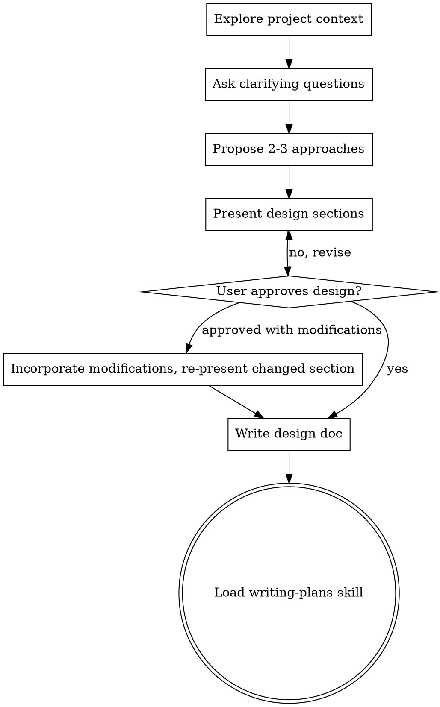

<!-- TIER-1: OVERVIEW — luôn load khi skill được trigger -->
# Brainstorming Ideas Into Designs

## Overview

Help turn ideas into fully formed designs and specs through natural collaborative dialogue.

Start by understanding the current project context, then ask questions one at a time to refine the idea. Once you understand what you're building, present the design and get user approval.

<HARD-GATE>
Do NOT invoke any implementation skill, write any code, scaffold any project, or take any implementation action until you have presented a design and the user has approved it. This applies to EVERY project regardless of perceived simplicity.

Announce: "Design HARD-GATE: I will not write code or scaffold files until you approve this design."

An implementation action is: writing any file that will be part of the product (src/, lib/, app/), running npm init/create-*, generating scaffolding.
</HARD-GATE>

## Anti-Pattern: "This Is Too Simple To Need A Design"

Every project goes through this process. A todo list, a single-function utility, a config change — all of them. "Simple" projects are where unexamined assumptions cause the most wasted work. The design can be short (a few sentences for truly simple projects), but you MUST present it and get approval.


<!-- TIER-2: PROCESS — load khi bắt đầu thực thi skill -->
## Greenfield Projects

If the project has no existing files: skip the "Explore project context" step, start directly with clarifying questions, and create the `docs/` directory as the first implementation action after approval.

## Checklist

You MUST create a task for each of these items and complete them in order:

1. **Explore project context** — check files, docs, recent commits
2. **Ensure Planning Mode** — prompt user to switch to **Planning Mode** if not already active
3. **Ask clarifying questions** — one at a time, understand purpose/constraints/success criteria
3. **Propose 2-3 approaches** — with trade-offs and your recommendation
4. **Present design** — in sections scaled to their complexity, get user approval after each section
5. **Write design doc** — save to `docs/plans/YYYY-MM-DD-<topic>-design.md` and commit
6. **Transition to implementation** — load writing-plans skill to create implementation plan

## Process Flow



**The terminal state is loading writing-plans.** Do NOT load frontend-design, mcp-builder, or any other implementation skill. The ONLY skill you load after brainstorming is writing-plans.


<!-- TIER-3: EXAMPLES & EDGE CASES — load khi cần reference chi tiết -->
## The Process

**Understanding the idea:**
- Check out the current project state first (files, docs, recent commits)
- Ask questions one at a time to refine the idea
- Prefer multiple choice questions when possible, but open-ended is fine too
- Only one question per message - if a topic needs more exploration, break it into multiple questions
- Focus on understanding: purpose, constraints, success criteria

**Termination criterion for clarifying questions:** Ask clarifying questions until: (a) you can restate the goal in one sentence, (b) you know the top constraint, (c) you understand the success criteria. Stop at 3-5 questions unless complexity demands more.

**Exploring approaches:**
- Propose 2-3 different approaches with trade-offs
- Present options conversationally with your recommendation and reasoning
- Lead with your recommended option and explain why

**Presenting the design:**
- Once you believe you understand what you're building, present the design
- Scale each section to its complexity: a few sentences if straightforward, up to 200-300 words if nuanced
- Ask after each section whether it looks right so far
- Cover: architecture, components, data flow, error handling, testing
- Be ready to go back and clarify if something doesn't make sense

**Handling partial approval:**
- If the user approves with modifications: incorporate the modifications, re-present the changed section only, then proceed
- Do not re-present unchanged sections

## After the Design

**Documentation:**
- Write the validated design to `docs/plans/YYYY-MM-DD-<topic>-design.md`
- Use elements-of-style:writing-clearly-and-concisely skill if available
- Commit the design document to git
- **INDEX design into context-mode KB** (available for /plan and /implement):
  ```
  → ctx_index(path: "docs/plans/<design-file>.md", source: "Design: <topic>")
  ```

### Standardized Output Template

The design document MUST include these sections (adjust depth to complexity):

```markdown
# [Feature/Topic Name]

## Problem Statement
[What problem does this solve? Why is it needed?]

## Requirements
- [ ] Functional requirement 1
- [ ] Functional requirement 2
- [ ] Non-functional: performance, security, etc.

## Constraints
- Technical: [frameworks, language, compatibility]
- Business: [timeline, budget, team capacity]
- Scope: [what is explicitly OUT of scope]

## Design Decisions
| Decision | Options Considered | Chosen | Rationale |
|----------|-------------------|--------|-----------|
| [decision 1] | A, B, C | B | [why B] |

## Architecture / Components
[Diagrams, data flow, component breakdown]

## Acceptance Criteria
- [ ] Criterion 1 (testable, specific)
- [ ] Criterion 2
- [ ] Criterion 3
```

> **Mandatory sections:** Problem Statement, Requirements, Acceptance Criteria.
> Other sections can be brief for simple features.

**Implementation:**
- Load the writing-plans skill to create a detailed implementation plan
- Do NOT load any other skill. writing-plans is the next step.

## JTBD Framework (inspired by CodyMaster cm-jtbd)

Use the **Jobs-To-Be-Done** template to structure requirements:

```
When [situation/trigger],
I want to [motivation/action],
So I can [desired outcome].
```

**Example:**
```
When I receive a customer support email,
I want to automatically classify and route it,
So I can reduce response time from 4 hours to 15 minutes.
```

**Use JTBD when:**
- User's request is vague or high-level
- Building a new product/feature (not fixing a bug)
- Multiple stakeholders with different needs

**Skip JTBD when:**
- Task is a clear bug fix
- User already provided detailed specifications

## Key Principles

- **One question at a time** - Don't overwhelm with multiple questions
- **Multiple choice preferred** - Easier to answer than open-ended when possible
- **YAGNI ruthlessly** - Remove unnecessary features from all designs
- **Explore alternatives** - Always propose 2-3 approaches before settling
- **Incremental validation** - Present design, get approval before moving on
- **Be flexible** - Go back and clarify when something doesn't make sense

## Integration

- **Rules**: `execution-integrity-core` (evidence gate), `auto-continue-loop` (post-task protocol)
- **Loaded by**: `agent-routing` rule (implicit keyword detection), workflow `STANDARD_PREAMBLE` (explicit)
- **Combines with**: See `agent-routing.md` Step 1c for multi-skill combo patterns
- **Memory**: Check `learned-rules/lessons.md` for relevant past lessons
