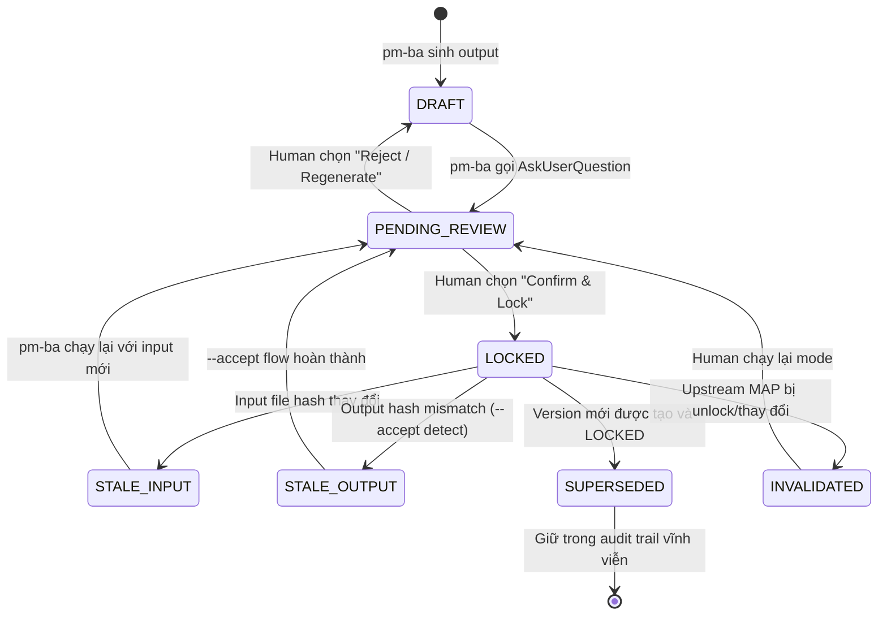
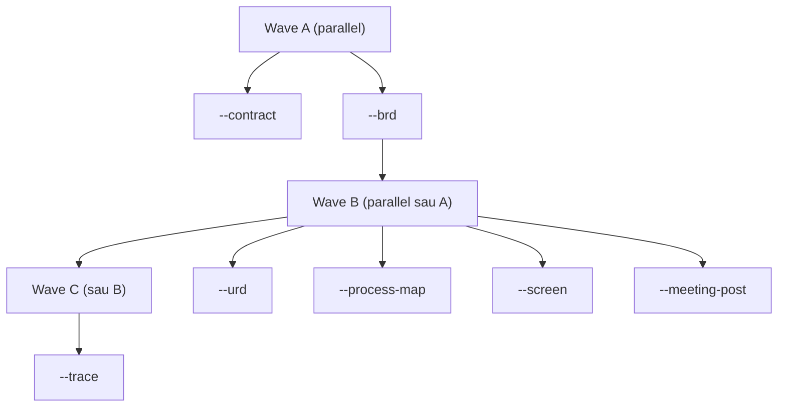

# IO-Mapping Protocol

**Version:** 1.0  
**Status:** Design Locked  
**Last Updated:** 2026-05-19  
**Owner:** pm-ba skill system

---

## 1. Purpose

IO-Mapping là cơ chế trung tâm đảm bảo **tính toàn vẹn và truy vết** của mọi output trong pipeline PM-BA. Protocol này định nghĩa:

- Ánh xạ 1-n giữa mỗi input document và các output files được sinh ra từ nó
- Cơ chế **LOCK** bảo vệ output đã được human review và approve
- Luồng **bidirectional**: pm-ba sinh output → human review/edit → pm-ba nhận lại
- **Audit trail** đầy đủ: mọi state transition đều được ghi log với timestamp
- **Snapshot** để rollback khi io-mapping.json bị corrupt

Protocol này là nguồn sự thật duy nhất (single source of truth) cho trạng thái của tất cả output files trong `docs/`. Không có script nào, không có AI mode nào được phép ghi đè lên một file LOCKED mà không thông qua cơ chế bypass được định nghĩa ở §8.

---

## 2. Data Schema

### 2.1 Top-level Structure

`docs/.pm-ba/io-mapping.json` có cấu trúc:

```json
{
  "schema_version": 1,
  "generated_at": "2026-05-19T15:22:00+07:00",
  "config": {
    "input_root": "G:/.../100_Local/04_Scope_local",
    "output_root": "G:/.../PM_PhanTich/docs",
    "human_export_root": "G:/.../PM_PhanTich/.docs_human"
  },
  "mappings": [ /* xem §2.2 */ ],
  "audit_log_path": "docs/.pm-ba/audit.log"
}
```

| Field | Type | Mô tả |
|-------|------|-------|
| `schema_version` | integer | Phiên bản schema; hiện tại = 1 |
| `generated_at` | ISO-8601 string | Thời điểm file được tạo/cập nhật lần cuối |
| `config` | object | Snapshot các đường dẫn từ `pm-ba.config.json` tại thời điểm tạo |
| `mappings` | array | Danh sách tất cả MAP entries (xem §2.2) |
| `audit_log_path` | string | Relative path đến audit log file |

### 2.2 Mapping Entry Schema

```json
{
  "map_id": "MAP-001",
  "input_path": "brd/BRD_QL_Sau_Vay_v1.md",
  "current_version": 2,
  "versions": [
    {
      "v": 1,
      "input_hash_sha256": "abc123...",
      "mode": "--brd",
      "outputs": [
        { "path": "docs/ba-brd-analysis.md", "hash_sha256": "def456..." },
        { "path": "docs/pm-traceability-matrix.md", "hash_sha256": "ghi789..." }
      ],
      "status": "SUPERSEDED",
      "locked_at": "2026-05-17T10:00:00+07:00",
      "locked_by": "human",
      "lock_notes": "Phân tích ban đầu",
      "supersedes_version": null,
      "consistency_check_report": null
    },
    {
      "v": 2,
      "input_hash_sha256": "abc2...",
      "mode": "--brd",
      "outputs": [
        { "path": "docs/ba-brd-analysis.md", "hash_sha256": "def2..." }
      ],
      "status": "LOCKED",
      "locked_at": "2026-05-19T14:30:00+07:00",
      "locked_by": "human",
      "lock_notes": "Cập nhật §3.2 theo CR-007",
      "supersedes_version": 1,
      "consistency_check_report": "plans/reports/consistency-check-260519-map-001.md"
    }
  ],
  "downstream_dependencies": ["MAP-005"]
}
```

| Field | Type | Mô tả |
|-------|------|-------|
| `map_id` | string | Unique ID, format `MAP-NNN` (zero-padded 3 digits) |
| `input_path` | string | Relative path từ `config.input_root` đến file input |
| `current_version` | integer | Số version đang active (trỏ đến entry trong `versions[]`) |
| `versions` | array | Append-only history; không bao giờ xóa entry cũ |
| `versions[].v` | integer | Version number, tăng đơn điệu từ 1 |
| `versions[].input_hash_sha256` | string | SHA-256 của input file tại thời điểm chạy (normalized) |
| `versions[].mode` | string | pm-ba mode flag đã chạy (ví dụ `--brd`, `--urd`) |
| `versions[].outputs` | array | Danh sách output files sinh ra từ version này |
| `versions[].outputs[].path` | string | Relative path từ `config.output_root` |
| `versions[].outputs[].hash_sha256` | string | SHA-256 của output file tại thời điểm lock |
| `versions[].status` | string | Trạng thái version (xem §2.3) |
| `versions[].locked_at` | ISO-8601 | Thời điểm human xác nhận lock; null nếu chưa lock |
| `versions[].locked_by` | string | `"human"` hoặc `"auto"` (migration) |
| `versions[].lock_notes` | string | Ghi chú của human khi lock |
| `versions[].supersedes_version` | integer\|null | Trỏ đến version bị thay thế |
| `versions[].consistency_check_report` | string\|null | Path đến report của subagent kiểm tra tính nhất quán |
| `downstream_dependencies` | string[] | Các MAP IDs phụ thuộc vào mapping này |

### 2.3 Status Values

| Status | Ý nghĩa | Ai set |
|--------|---------|--------|
| `DRAFT` | pm-ba vừa sinh output, chưa human review | pm-ba |
| `PENDING_REVIEW` | Đang chờ human xác nhận qua AskUserQuestion | pm-ba |
| `LOCKED` | Human đã confirm, hook bảo vệ khỏi ghi đè | human (qua prompt) |
| `STALE_INPUT` | Input file đã thay đổi (hash mismatch) kể từ lần lock cuối | pm-ba (scan) |
| `STALE_OUTPUT` | Output file bị sửa ngoài luồng (không qua --accept) | pm-ba --accept |
| `SUPERSEDED` | Version cũ, đã có version mới thay thế | pm-ba (auto khi tạo version mới) |
| `INVALIDATED` | Bị vô hiệu hóa do upstream dependency bị unlock/thay đổi | pm-ba (cascade) |

---

## 3. State Machine

### 3.1 Sơ đồ Trạng thái



### 3.2 State transitions (canonical)

| Event | From | To | Triggered by |
|-------|------|----|--------------|
| CREATE | (none) | DRAFT | Migration / new analysis run |
| LOCK_CONFIRM | DRAFT, PENDING_REVIEW | LOCKED | Human confirms via AskUserQuestion |
| UNLOCK_SELF | LOCKED | DRAFT | `ck:pm-ba --unlock MAP-NNN` |
| UNLOCK_CASCADE | LOCKED (downstream of unlocked mapping) | STALE_INPUT | Cascade from UNLOCK_SELF |
| INPUT_CHANGE | LOCKED | STALE_INPUT | Detected by handler-input-mode on hash mismatch |
| OUTPUT_CHANGE | LOCKED | STALE_OUTPUT | Detected by handler-accept on output hash mismatch |
| ACCEPT_PASS | STALE_OUTPUT | PENDING_REVIEW → LOCKED (v+1) | Subagent verdict PASS + `--auto-confirm` |
| ACCEPT_FAIL | STALE_OUTPUT | LOCKED (no version bump) | Subagent verdict FAIL — keeps original lock |

**Correction notice:** v1.7.0 specified `--unlock` set target to STALE_INPUT (§8.1 vs §3.1 contradiction). v1.8.0 canonical: target → DRAFT, downstream cascade → STALE_INPUT.

### 3.3 Bảng Transition (deprecated — see §3.2)

| Từ trạng thái | Đến trạng thái | Trigger | Điều kiện |
|---------------|----------------|---------|-----------|
| _(new)_ | `DRAFT` | pm-ba mode chạy xong | Output files được ghi |
| `DRAFT` | `PENDING_REVIEW` | pm-ba gọi AskUserQuestion | Luôn luôn |
| `PENDING_REVIEW` | `LOCKED` | Human chọn "Lock" | Trong AskUserQuestion |
| `PENDING_REVIEW` | `DRAFT` | Human chọn "Reject" | Trong AskUserQuestion |
| `LOCKED` | `STALE_INPUT` | pm-ba --io-status detect hash mismatch | `input_hash != current_hash` |
| `LOCKED` | `STALE_OUTPUT` | pm-ba --accept detect output edited | `output_hash != file_hash` |
| `STALE_INPUT` | `PENDING_REVIEW` | pm-ba chạy lại với input mới | Sau khi sinh output mới |
| `STALE_OUTPUT` | `PENDING_REVIEW` | --accept flow + consistency check | Report được sinh |
| `LOCKED` | `SUPERSEDED` | Tạo version mới thành công | `current_version` tăng |
| `LOCKED` | `INVALIDATED` | Upstream MAP thay đổi | `downstream_dependencies` cascade |

---

## 4. Flow A: Input → Output (Chế độ bình thường)

Flow này được thực thi khi human chạy `ck:pm-ba --brd` (hoặc bất kỳ mode nào).

### 4.1 Các bước

**Bước 1: Xác định input file**
```
input_path = resolve(config.input_root, input_subfolder, filename)
```
pm-ba đọc input từ `config.input_root` (không dùng relative `../`).

**Bước 2: Tính hash input**
```javascript
const inputHash = await normalizeAndHash(input_path);
// Dùng normalize-hash.cjs: strip BOM, LF only, trim trailing whitespace
```

**Bước 3: Tra cứu mapping**
```javascript
const existing = mappings.find(m => m.input_path === relativeInputPath);
```

**Bước 4: Kiểm tra idempotency**
```
Nếu existing tồn tại VÀ current version có status = LOCKED VÀ input_hash == existing.versions[current].input_hash_sha256:
  → LOG "[IO-MAP] Skipped: input unchanged, output LOCKED"
  → EXIT (không ghi đè output)
Nếu existing tồn tại VÀ status = LOCKED VÀ input_hash != existing hash:
  → SET status = STALE_INPUT
  → Tiếp tục bước 5
```

**Bước 5: Sinh output**

pm-ba chạy phân tích, ghi output files ra `docs/`. Tất cả file trong `docs/` được hook kiểm tra — nếu LOCKED thì bị chặn (trừ khi có bypass, xem §8).

**Bước 6: Cập nhật io-mapping — DRAFT**
```javascript
const newVersion = {
  v: (existing?.current_version ?? 0) + 1,
  input_hash_sha256: inputHash,
  mode: currentMode,
  outputs: outputFiles.map(f => ({ path: f.path, hash_sha256: computeHash(f) })),
  status: "DRAFT",
  locked_at: null,
  locked_by: null,
  lock_notes: null,
  supersedes_version: existing?.current_version ?? null,
  consistency_check_report: null
};
// Atomic write: tmp → fsync → rename
```

**Bước 7: Chuyển sang PENDING_REVIEW + AskUserQuestion**

pm-ba gọi `AskUserQuestion` với prompt:
```
Header: "IO-Mapping: Lock Output?"
Question: "Output cho [input_path] đã được sinh (v{N}). Bạn có muốn Lock?"
Options:
  - "Confirm & Lock" — set status LOCKED, điền locked_at/locked_by
  - "Review trước" — giữ PENDING_REVIEW, human tự sửa output rồi chạy --accept
  - "Reject / Tái sinh" — set status DRAFT, pm-ba sẽ chạy lại khi được yêu cầu
```

**Bước 8: Xử lý phản hồi**

- **"Confirm & Lock"**: cập nhật version status → `LOCKED`, ghi `locked_at = now()`, ghi `locked_by = "human"`, tạo snapshot, ghi audit log.
- **"Review trước"**: giữ `PENDING_REVIEW`. Human xem output, sau đó chạy `ck:pm-ba --accept`.
- **"Reject"**: set `DRAFT`, không ghi audit lock event.

---

## 5. Flow B: Human Edits → --accept (Luồng ngược)

Flow này xử lý khi human chỉnh sửa output file trong `docs/` (thường sau khi export → edit trong `.docs_human/` → import lại).

### 5.1 Điều kiện kích hoạt

Human chạy `ck:pm-ba --accept` sau khi đã edit `docs/` files.

### 5.2 Các bước

**Bước 1: Quét docs/ — phát hiện thay đổi**
```javascript
for (const mapping of mappings) {
  const version = mapping.versions[mapping.current_version - 1];
  if (version.status !== 'LOCKED') continue;
  for (const output of version.outputs) {
    const currentHash = normalizeAndHash(output.path);
    if (currentHash !== output.hash_sha256) {
      // Output đã bị sửa → STALE_OUTPUT
      flagged.push({ map_id: mapping.map_id, output, currentHash });
    }
  }
}
```

**Bước 2: Kiểm tra tính nhất quán bằng subagent**

Với mỗi `STALE_OUTPUT`, pm-ba spawn một `researcher` subagent để:
- So sánh output mới với input gốc
- Kiểm tra không có mâu thuẫn nội dung
- Sinh report ra `plans/reports/consistency-check-{date}-{map_id}.md`

**Bước 3: Trình bày evidence cho human**

pm-ba tổng hợp:
```
MAP-001 (ba-brd-analysis.md):
  Input: brd/BRD_QL_Sau_Vay_v1.md (unchanged)
  Output hash đã thay đổi: def456... → xyz789...
  Consistency check: PASS (xem plans/reports/consistency-check-260519-map-001.md)
  Thay đổi chính: §3.2 cập nhật mô tả luồng xử lý
```

**Bước 4: AskUserQuestion xác nhận re-lock**

```
Header: "IO-Mapping: Re-Lock sau Human Edit?"
Question: "Các output sau đã được sửa và kiểm tra tính nhất quán. Xác nhận re-lock?"
Options:
  - "Lock tất cả" — set tất cả STALE_OUTPUT → LOCKED với version mới
  - "Lock từng cái" — hỏi riêng từng file
  - "Hủy" — giữ STALE_OUTPUT, không lock
```

**Bước 5: Cập nhật mapping**

Với mỗi output được confirm:
```javascript
// Tạo version mới (increment v)
const newV = {
  ...previousVersion,
  v: previousVersion.v + 1,
  outputs: updatedOutputsWithNewHashes,
  status: "LOCKED",
  locked_at: now(),
  locked_by: "human",
  lock_notes: userNotes,
  supersedes_version: previousVersion.v,
  consistency_check_report: reportPath
};
// Set previousVersion.status = "SUPERSEDED"
// Atomic write
```

**Bước 6: Cập nhật `bypass_io_lock`**

Trong quá trình --accept, các tool calls Write/Edit lên `docs/` được đánh dấu `bypass_io_lock: true` để hook không chặn (xem §7).

---

## 6. Flow Full: --full Mode Execution

`ck:pm-ba --full` chạy toàn bộ pipeline theo thứ tự dependency.

### 6.1 Dependency Wave



### 6.2 Wave plan schema

`handler-full.cjs` produces a wave plan as JSON to stdout. Claude orchestrator (AI tier) reads and executes via Task tool.

```json
{
  "waves": [
    {
      "wave": "A",
      "parallel": true,
      "modes": ["contract", "brd"],
      "inputs": [
        { "mode": "contract", "path": "...", "hash": "...", "existing_map_id": null|"MAP-NNN", "skip": false }
      ]
    },
    {
      "wave": "B",
      "parallel": true,
      "modes": ["urd", "process-map", "screen", "meeting-post"],
      "depends_on": "A"
    },
    {
      "wave": "C",
      "parallel": false,
      "modes": ["trace"],
      "depends_on": "B"
    }
  ],
  "state_file": "<path>",
  "resumed_from": "A|B|null"
}
```

### 6.3 State file schema (`docs/.pm-ba/full-state.json`)

```json
{
  "started_at": "ISO 8601",
  "current_wave": "A|B|C",
  "completed_waves": ["A"],
  "errors": [],
  "wave_inputs": { "A": [...], "B": [...], "C": [] }
}
```

### 6.4 Resume protocol

- `ck:pm-ba --full --resume <state-file>` reads state, omits completed waves from output plan
- Claude orchestrator updates `completed_waves` after each successful wave
- On wave failure: state file retains last successful wave; subsequent resume picks up from failed wave (NOT next wave)

### 6.5 `--skip-locked` semantics

- For each input, look up matching mapping
- If `current_version.status === 'LOCKED'` AND `input.hash_sha256 === computed_hash` → mark `skip: true`
- Skipped inputs appear in plan with `skip: true`; orchestrator omits Task spawn for them

### 6.6 Failure rollback

- Snapshot before each wave: `snapshotAndRotate(ioMappingPath, 'pre-wave-A')`
- On wave failure: orchestrator either restores from snapshot OR records error and aborts
- PENDING_REVIEW inputs in Wave B block Wave C until resolved (Claude prompts user via AskUserQuestion)

### 6.7 Thực thi Wave (implementation details)

**Wave A** — Chạy song parallel: `--contract` và `--brd`
- Mỗi mode sinh output → DRAFT → AskUserQuestion lock prompt
- Wave A hoàn thành khi **tất cả** Wave A outputs đều là LOCKED hoặc PENDING_REVIEW

**Wave B** — Chạy song parallel sau khi Wave A có ít nhất `--brd` LOCKED:
- `--urd`, `--process-map`, `--screen`, `--meeting-post`
- Mỗi mode đọc output từ Wave A làm context bổ sung
- AskUserQuestion lock prompt per output

**Wave C** — Chạy sau khi Wave B hoàn thành:
- `--trace` đọc tất cả outputs từ Wave A + B
- Sinh traceability matrix
- AskUserQuestion lock prompt

### 6.8 Lock Prompt Per Wave

Sau mỗi wave, trước khi chạy wave tiếp theo, pm-ba hỏi:
```
"Wave A đã hoàn thành. Các outputs sau đây đang ở trạng thái PENDING_REVIEW:
  - docs/ba-contract-analysis.md (MAP-001)
  - docs/ba-brd-analysis.md (MAP-002)
Lock tất cả trước khi tiếp tục Wave B?"
```

Human có thể chọn: "Lock tất cả và tiếp tục" / "Review từng cái" / "Tạm dừng".

---

## 7. Lock Enforcement (Hai tầng)

### 7.1 Tầng 1: Hook `pre-write-io-mapping-check.cjs`

Hook được đăng ký trong `.claude/settings.json` dưới `hooks.PreToolUse`. Khi bất kỳ tool nào trong `{Write, Edit, MultiEdit, NotebookEdit}` được gọi với `file_path` nằm trong `docs/`:

1. Hook đọc `docs/.pm-ba/io-mapping.json`
2. Tìm mapping có output trỏ đến file đó
3. Nếu version hiện tại có `status = LOCKED` → **exit 1** (block)
4. Nếu `tool_input.bypass_io_lock = true` → **exit 0** (allow với log)
5. Mọi lỗi nội bộ → **exit 1** với prefix `[IO-MAP-HOOK-INTERNAL]` (fail-closed)

**Hook message khi block:**
```
⛔ [IO-MAP-LOCK] docs/ba-brd-analysis.md is LOCKED in IO-mapping (MAP-001 v2).
   Locked by human at 2026-05-19T14:30:00+07:00.
   To modify: run 'ck:pm-ba --unlock MAP-001' OR 'ck:pm-ba --accept' to update lock.
```

### 7.2 Tầng 2: Invariant 20 trong SKILL.md

SKILL.md định nghĩa Invariant 20:

> **Invariant 20 — IO-Mapping Lock Protection:**  
> Trước khi ghi bất kỳ file nào vào `docs/`, AI phải kiểm tra `io-mapping.json`. Nếu file target có status LOCKED và không có `bypass_io_lock` context, AI phải từ chối và hiển thị thông báo tương tự hook.

Hai tầng này hoạt động độc lập — nếu hook bị tắt (settings.json mất hoặc bị xóa), Invariant 20 vẫn bảo vệ. Nếu AI bỏ qua invariant, hook chặn ở tool level.

### 7.3 Consistency-check subagent prompt template

When `handler-accept.cjs` emits `actions[].type === 'consistency_check_requested'`, Claude spawns subagent with this prompt template (verbatim, fill placeholders):

```
Task: Verify output file <output_path> remains consistent with input file <input_path> after manual edit.

Context:
  Input hash (stored): <stored_input_hash>
  Input hash (current): <current_input_hash>  [same if input unchanged]
  Output hash (stored): <stored_output_hash>
  Output hash (current): <current_output_hash>  [different — manual edit]
  Mode: <mode>
  Mapping: <map_id> v<N>

Read:
  - Input file: <input_path>
  - Current output file: <output_path>
  - Mapping context: docs/.pm-ba/io-mapping.json#<map_id>

Evaluate:
  1. Does current output still satisfy what input intends?
  2. Are there semantic conflicts or missing requirements?
  3. Is the edit additive (clarification) or contradictory (rework needed)?

Output:
  Fill the "## Subagent Findings" section in <report_path>
  Set verdict: - [x] PASS (consistent) or - [x] FAIL (inconsistent)
  Provide recommendation
```

### 7.4 Report schema

Each consistency check generates `plans/reports/consistency-check-{YYMMDD}-{MAP-NNN}.md` with sections:
- `## Subagent Analysis Request` (handler-generated)
- `## Subagent Findings` (subagent fills)
- `## Verdict` — checkbox `- [ ] PASS` / `- [ ] FAIL`
- `## Recommendation` (subagent fills)

### 7.5 PASS path

1. Claude detects `- [x] PASS` in report
2. Re-invokes `node handler-accept.cjs --map <id> --auto-confirm`
3. Handler:
   - Snapshots io-mapping
   - Appends new version v(N+1) with `status: PENDING_REVIEW`, recomputed output hash
   - Audit: `ACCEPT_PASS`, `SUPERSEDE`
4. Claude prompts user via AskUserQuestion → LOCK_CONFIRM event → status LOCKED

### 7.6 FAIL path

1. Claude detects `- [x] FAIL`
2. Re-invokes handler with --auto-confirm
3. Handler keeps current LOCKED (no version bump)
4. Audit: `ACCEPT_FAIL`
5. Claude reports back to user with subagent recommendation; user must edit input or output and re-run --accept

---

## 8. Bypass Mechanisms

Chỉ có 2 cách hợp lệ để bypass LOCK:

### 8.1 `--unlock <map_id>`

```
ck:pm-ba --unlock MAP-001
```

Thực thi:
1. AskUserQuestion: "Bạn chắc chắn muốn unlock MAP-001? Lý do:"
2. Human nhập lý do
3. pm-ba set version hiện tại: `status = STALE_INPUT` (không xóa version, không mất audit)
4. Ghi audit log: `{timestamp} UNLOCK MAP-001 reason="..." by=human`
5. Downstream dependencies được set `INVALIDATED` với cascade log

**Không có** `--force-unlock` — mọi unlock đều yêu cầu human confirm.

### 8.2 `--accept` (Bypass tích hợp)

Khi pm-ba chạy `--accept` flow (§5), nó tự động set `bypass_io_lock: true` trong tool input cho mọi Write/Edit call trong session đó. Hook nhận diện flag này và cho phép, đồng thời log:

```
[IO-MAP-HOOK] Bypass authorized for docs/ba-brd-analysis.md (map=MAP-001)
```

Bypass chỉ có hiệu lực trong phạm vi `--accept` session. Không thể set thủ công từ ngoài.

---

## 9. Versioning & Audit

### 9.1 Versioning Principles

- `versions[]` là **append-only**: không bao giờ xóa hoặc sửa entry cũ
- `current_version` luôn trỏ đến version có index cao nhất có status `LOCKED`
- Version mới chỉ được tạo khi:
  - Input thay đổi (hash mismatch)
  - Human edit output và chạy `--accept`
  - Human chạy `--unlock` rồi `--brd` lại
- `supersedes_version` tạo chain: v3 → v2 → v1 (có thể trace lịch sử)

### 9.2 Audit log format

Path: `docs/.pm-ba/audit.log`

**Line format (6 pipe-separated fields, ending with `\n`):**

```
<ISO 8601 UTC> | <actor> | <event_type> | <map_id> | v=<N> | <details>
```

Fields:
- **Timestamp**: ISO 8601 UTC, e.g. `2026-05-19T16:33:00.123Z`
- **Actor**: `human` | `script` | `hook`
- **Event type**: see enum below
- **Map ID**: `MAP-NNN` or empty
- **Version**: `v=N` integer prefix; empty if not applicable
- **Details**: free text (no `|` chars)

**Event type enum (complete, from `audit-log.cjs`):**

- `CREATE` — initial mapping creation
- `LOCK` — version → LOCKED
- `UNLOCK` — LOCKED → DRAFT
- `SUPERSEDE` — new version pushes old
- `ACCEPT_PASS` — --accept consistency PASS
- `ACCEPT_FAIL` — --accept consistency FAIL
- `STALE_INPUT_DETECTED`
- `STALE_OUTPUT_DETECTED`
- `VALIDATE_OK`
- `VALIDATE_FAIL`
- `ROLLBACK` — snapshot restored
- `MIGRATE` — legacy bulk migration
- `LOCK_BLOCKED` — hook blocked a write
- `BYPASS_USED` — bypass_io_lock flag triggered

**Examples:**

```
2026-05-19T14:30:00.000Z | human | LOCK | MAP-001 | v=2 | notes: CR-007
2026-05-19T15:00:00.000Z | script | STALE_INPUT_DETECTED | MAP-002 | v=1 | input hash changed
2026-05-19T15:30:00.000Z | human | UNLOCK | MAP-001 | v=1 | reason: Rewrite §4
2026-05-19T16:00:00.000Z | hook | BYPASS_USED | MAP-001 | v=2 | tool: Write, mode: --accept
2026-05-19T16:30:00.000Z | script | SUPERSEDE | MAP-001 | v=2 | old_v: 1
2026-05-19T17:00:00.000Z | script | ROLLBACK | MAP-001 | | from snapshot: io-mapping-20260519T170000.json
2026-05-19T17:30:00.000Z | script | MIGRATE | MAP-003 | v=1 | source: existing_doc, auto_locked: true
```

**Append-only.** No edit/delete on existing entries. Atomic append via `fs.appendFileSync` with O_APPEND (POSIX-safe per-write atomic).

**Rotation:** Yearly recommended; out of v1.8.0 scope — see roadmap for v1.9.0.

### 9.3 Snapshot Policy

Mỗi lần io-mapping.json được cập nhật thành công:
1. Copy hiện tại vào `docs/.pm-ba/snapshots/io-mapping-{ISO_TIMESTAMP}.json`
2. Giữ tối đa `config.max_snapshots` (mặc định 5) bản gần nhất
3. Xóa bản cũ nhất nếu vượt quá giới hạn
4. Ghi audit log event `SNAPSHOT`

---

## 10. Migration từ Existing State

Khi hệ thống được bootstrap lần đầu trên một project đã có `docs/` files, script `io-mapping-migrate.cjs` thực hiện:

### 10.1 Chế độ Dry-run

```bash
node io-mapping-migrate.cjs --dry-run
```

In ra danh sách tất cả output files sẽ được migrate, với input inferred. Không ghi bất kỳ file nào. Thích hợp để xem trước trước khi chạy thực.

### 10.2 Chế độ thực thi

```bash
node io-mapping-migrate.cjs [--auto-lock]
```

**Thuật toán:**

1. **Quét `docs/`** — tìm tất cả files khớp pattern `pm-*.md` hoặc `ba-*.md`, loại trừ:
   - `pm-ba-io-mapping.md` (auto-generated view)
   - `pm-ba-document-status.md`
   - `pm-ba-output-registry.md`

2. **Infer input** — với mỗi output file:
   - `ba-brd-analysis.md` → tìm trong `input_root/brd/*.md`
   - `ba-urd-*.md` → tìm trong `input_root/urd/*.md`
   - `pm-traceability-*.md` → tìm cả `brd/` và `urd/`
   - Nếu tìm được 1 candidate: auto-assign
   - Nếu nhiều candidates: **hỏi human** qua stdin prompt
   - Nếu không tìm được: tạo orphan entry với `input_path = null`

3. **Tính hash** — dùng `normalize-hash.cjs` cho cả input (nếu tìm được) và output

4. **Tạo MAP entry** — với `status = LOCKED` (bảo toàn công sức human đã có)

5. **Nếu `--auto-lock`**: bỏ qua stdin prompt, tự động LOCKED tất cả

6. **Khởi tạo `docs/.pm-ba/`** nếu chưa tồn tại:
   - Tạo thư mục `docs/.pm-ba/` và `docs/.pm-ba/snapshots/`
   - Ghi `io-mapping.json` (atomic write)
   - Ghi `audit.log` với event `MIGRATE` cho mỗi entry

### 10.3 Xử lý Orphan

Outputs không có input source được tạo với:
```json
{
  "map_id": "MAP-XXX",
  "input_path": null,
  "current_version": 1,
  "versions": [{
    "status": "LOCKED",
    "lock_notes": "MIGRATED: no input source found",
    ...
  }]
}
```

Orphans được hiển thị nổi bật trong `pm-ba-io-mapping.md` để human xử lý sau.

---

## 11. Bypass mechanism — `bypass_io_lock`

### 11.1 Scope

`bypass_io_lock` is a **per-`ck:pm-ba`-invocation** flag stored in `.claude/pm-ba.config.json`. It is NOT session-wide and NOT persistent.

### 11.2 Lifecycle

1. **Set:** `handler-unlock.cjs` sets `bypass_io_lock: true` when transitioning a mapping → DRAFT
2. **Active window:** Only valid for the current `ck:pm-ba` invocation
3. **Cleared by:**
   - `session-start` hook (Phase 5 ensures this) sets `bypass_io_lock: false` at every new Claude session
   - Explicit `ck:pm-ba --lock` command (if implemented in future)

### 11.3 Hook behavior under bypass

When `pre-write-io-mapping-check.cjs` finds a LOCKED match:
- If `bypass_io_lock === true`: emit `BYPASS_USED` audit event and exit 0 (write allowed)
- If `bypass_io_lock === false` or undefined: emit `LOCK_BLOCKED` audit and exit 1 (write blocked)

### 11.4 Audit trail

Every write performed under bypass produces a `BYPASS_USED` audit entry with `actor=hook`, `tool=<tool_name>`, `target=<path>`. This is the forensic record.

### 11.5 Conflict resolution

`bypass_io_lock` is checked AFTER the LOCKED match is found. Bypass overrides the block but the override is logged. Goal: zero silent overrides.

---

## 12. Recovery

### 12.1 Phát hiện Corruption

`io-mapping-validator.cjs` chạy on-demand hoặc được pm-ba gọi tự động khi session bắt đầu:

```bash
node io-mapping-validator.cjs [--fix]
```

Các kiểm tra:
1. JSON parse thành công
2. `schema_version` == 1
3. Mỗi `map_id` là unique
4. `current_version` trỏ đến entry tồn tại trong `versions[]`
5. Version numbers là monotonic (1, 2, 3...)
6. SUPERSEDED versions có `supersedes_version` hợp lệ
7. LOCKED outputs tồn tại trên disk
8. Không có cycle trong `downstream_dependencies` (max depth 10)

### 12.2 Tự động Restore

Với flag `--fix`:
1. Tìm snapshot gần nhất trong `docs/.pm-ba/snapshots/`
2. Validate snapshot (nếu cũng corrupt, thử snapshot tiếp theo)
3. Nếu tìm được snapshot hợp lệ:
   - Copy snapshot → `io-mapping.json` (atomic write)
   - Ghi audit log: `RESTORE from snapshots/io-mapping-{ts}.json`
   - Báo cáo: "Restored from snapshot dated {ts}"
4. Nếu tất cả snapshots corrupt → exit 1 với hướng dẫn khôi phục thủ công

**Exit codes:**
- `0` = valid
- `1` = invalid + không fix được
- `2` = đã restore từ snapshot thành công

### 12.3 Manual Recovery

Nếu tất cả snapshots mất:
1. Chạy `io-mapping-migrate.cjs --dry-run` để xem state hiện tại
2. Chạy `io-mapping-migrate.cjs --auto-lock` để rebuild từ docs/ hiện tại
3. Ghi chú: version history bị mất, tất cả entries sẽ là v1

---

## 13. Cross-References

Các tài liệu liên quan cần đọc cùng protocol này:

| Tài liệu | Mô tả | Liên quan đến |
|---------|-------|---------------|
| `references/artifact-naming.md` | Quy ước đặt tên output files (`ba-*.md`, `pm-*.md`) | §2.2 — infer input từ output name |
| `references/state-and-continuity.md` | Session state, memory persistence giữa các lần chạy | §4 — idempotency check |
| `references/document-ingest-protocol.md` | Cách pm-ba đọc input files từ `input_root` | §4 Bước 1 — xác định input file |
| `references/00-intent-routing.md` | NL patterns để trigger `--full`, `--accept`, `--io-status`, `--unlock` | §6 — full mode trigger |
| `SKILL.md` — Invariant 20 | AI-level lock enforcement | §7.2 — tầng 2 enforcement |
| `.claude/hooks/pre-write-io-mapping-check.cjs` | Hook implementation | §7.1 — tầng 1 enforcement |
| `.claude/pm-ba.config.json` | Canonical paths (input_root, output_root, store_path) | Toàn bộ protocol |
| `scripts/normalize-hash.cjs` | SHA-256 normalized hash computation | §4 Bước 2, §5 Bước 1 |
| `scripts/io-mapping-migrate.cjs` | Bootstrap script | §10 — migration |
| `scripts/io-mapping-validator.cjs` | Integrity checker | §11 — recovery |
| `scripts/io-mapping-render-md.cjs` | Generates human-readable view | Audit/visibility |
