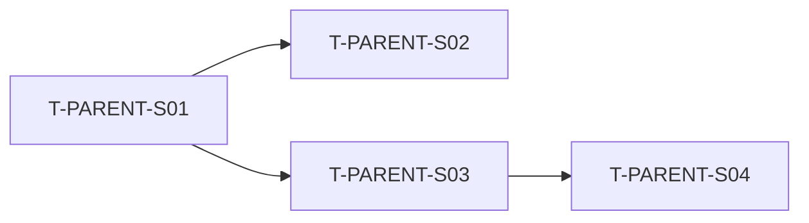

# Decompose Proposal — {parent_task_id}

> Auto-generated by Mode 52 `--kpi-decompose`. PM edit + run `--kpi-decompose --confirm <this-file>` to lock.

## 1. Parent Task

- ID: {parent_task_id}
- Description: {parent_description}
- P-level: {parent_P}
- TP: {parent_TP}, mds: {parent_mds}
- Source: {URD path or master-task-list entry}

## 2. Strategy Selected

- Auto-detected: **{strategy}** (confidence: {pct}%)
- Detection signals:
  - Entities found: {n} — {list}
  - Layers found: {n} — {list}
  - Verbs found: {n} — {list}
- PM override: `--strategy crud|layer|verb|hybrid`

## 3. Subtask Register (PM edit columns marked [CONFIRM])

| Subtask ID | Description | Strategy Axis | P [?] | TP | mds | Dependencies | Notes |
|-----------|-------------|---------------|--------|-----|------|--------------|-------|
| T-{PARENT}-S01 | {sub_desc_1} | {axis_1} | [?] | | | — | |
| T-{PARENT}-S02 | {sub_desc_2} | {axis_2} | [?] | | | T-{PARENT}-S01 | |

## 4. Dependency Graph



Cycle check: ✅ no cycles | ❌ cycle found at: {path}

## 5. AC Coverage Check

| Parent AC | Covered By |
|-----------|------------|
| AC-1: {desc} | T-PARENT-S01 |
| AC-2: {desc} | T-PARENT-S02 + T-PARENT-S03 |
| AC-3: {desc} | ⚠️ MISSING — needs new subtask |

Coverage status: ✅ complete | ⚠️ {n} gaps

## 6. Team Composition Recommendation

- Required levels: {e.g., 2× Junior02 + 1× Senior01}
- Roster check: {pass/fail vs current team_roster}
- Suggested assignees: (auto-fill, PM override OK)

## 7. Anti-Pattern Check

- [ ] Subtask count {n} ≤ 15 (over-decomp)
- [ ] All subtasks ≥ 0.3 × target_mds (under-merge)
- [ ] No circular dependencies
- [ ] All parent ACs covered
- [ ] Recursive depth ≤ 2

## 8. Validation Rules (--confirm enforces)

- [ ] Every row's `P [?]` replaced with valid P-level
- [ ] No empty Description / Strategy Axis
- [ ] No `[?]` markers remaining
- [ ] No cycles in dependency graph
- [ ] All AC gaps resolved (either: covered by new subtask, OR explicitly defer with Notes)

## 9. Next Steps

After PM edit:
```
/pm-ba --kpi-decompose --confirm plans/reports/kpi-decompose-{date}-{parent}-{slug}.md
```

After confirm:
- Subtasks appended to `docs/pm-ba-master-task-list.md`
- Parent marked `decomposed_into: [S01..S0N]`
- Suggested: `--kpi-assign` to auto-assign new subtasks
