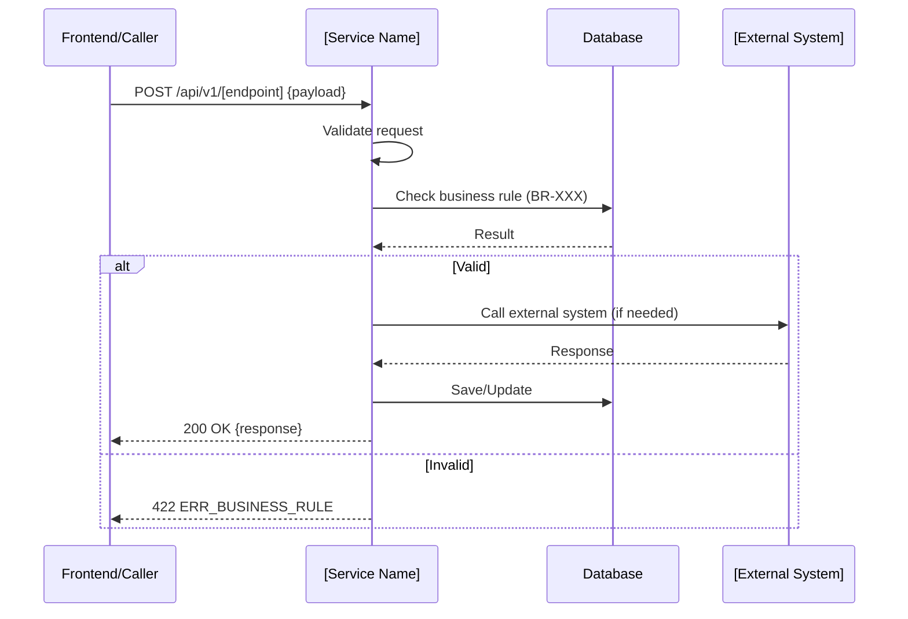

# API Contract: API-XXX — [Endpoint Name]

> **Usage:** One file per API endpoint or logical API group (e.g. all CRUD for one resource).
> Mark undefined fields with `[?]` — these become open issues for provider/internal team.

---

## Overview

| Field | Value |
|-------|-------|
| **API ID** | API-XXX |
| **Endpoint** | `GET/POST/PUT/PATCH/DELETE /api/v1/...` |
| **System** | Internal / T24 / CIC / NAPAS / External — [System Name] |
| **Auth** | Bearer JWT / API Key (header: X-API-Key) / mTLS / None |
| **SLA** | < XXX ms (p95) |
| **Idempotency** | Yes — key field: `[idempotencyKey]` / No |
| **Rate Limit** | XXX calls/min / None |
| **Linked URD** | Section X.X of [URD filename] |
| **Linked FR** | FR-XXX |
| **Linked US** | US-XXX |
| **Trigger** | [Which process step / user action calls this API] |
| **Created** | YYYY-MM-DD |
| **Status** | Draft / Review / Confirmed |

---

## Request

### Headers

| Header | Required | Value / Description |
|--------|----------|-------------------|
| Content-Type | Yes | application/json |
| Authorization | Yes | Bearer {jwt_token} |
| X-Request-ID | Yes | UUID — for tracing |
| X-Idempotency-Key | [Yes/No] | UUID — prevent duplicate calls |

### Path Parameters (if applicable)

| Parameter | Type | Required | Description | Example |
|-----------|------|----------|-------------|---------|
| `{id}` | UUID | Yes | Contract ID | `a1b2c3d4-...` |

### Query Parameters (GET only)

| Parameter | Type | Required | Default | Description | Example |
|-----------|------|----------|---------|-------------|---------|
| `page` | Integer | No | 1 | Page number | `1` |
| `pageSize` | Integer | No | 20 | Items per page | `20` |
| `status` | String | No | — | Filter by status | `ACTIVE` |

### Request Body (POST/PUT/PATCH)

```json
{
  "fieldName": "string — required — mô tả nghiệp vụ (VN)",
  "fieldName2": "number — required — mô tả",
  "optionalField": "string — optional — mô tả",
  "nestedObject": {
    "subField": "string — required"
  },
  "arrayField": [
    {
      "itemField": "string — required"
    }
  ]
}
```

#### Request Field Definitions

| Field | Type | Required | Validation | Business Rule | Example |
|-------|------|----------|------------|---------------|---------|
| `fieldName` | String | Yes | Max 100 chars | BR-XXX | "HĐ-2024-001" |
| `fieldName2` | Decimal | Yes | > 0 | BR-YYY | 500000000 |
| `optionalField` | String | No | Enum: A, B, C | | "A" |

---

## Response (200 OK)

```json
{
  "success": true,
  "data": {
    "id": "uuid",
    "fieldName": "string — mô tả",
    "status": "string — ACTIVE | INACTIVE | PENDING",
    "createdAt": "ISO 8601 datetime"
  },
  "meta": {
    "requestId": "uuid — echo của X-Request-ID",
    "timestamp": "ISO 8601"
  }
}
```

#### Response Field Definitions

| Field | Type | Always Present | Description (VN) | Notes |
|-------|------|----------------|-----------------|-------|
| `success` | Boolean | Yes | Trạng thái xử lý | true = thành công |
| `data.id` | UUID | Yes | ID của resource | |
| `data.status` | String | Yes | Trạng thái | Enum: ACTIVE/INACTIVE/PENDING |
| `data.createdAt` | String | Yes | Thời gian tạo | ISO 8601 format |

---

## Response (Paginated List — if applicable)

```json
{
  "success": true,
  "data": {
    "items": [ { ... } ],
    "total": 100,
    "page": 1,
    "pageSize": 20,
    "totalPages": 5
  }
}
```

---

## Error Responses

| HTTP Status | Error Code | Message (EN) | Message (VN) | When |
|-------------|------------|-------------|-------------|------|
| 400 | ERR_VALIDATION | Validation failed | Dữ liệu không hợp lệ | Missing required field or invalid format |
| 401 | ERR_UNAUTHORIZED | Unauthorized | Chưa xác thực | Missing or invalid token |
| 403 | ERR_FORBIDDEN | Forbidden | Không có quyền truy cập | Valid token but insufficient role |
| 404 | ERR_NOT_FOUND | Resource not found | Không tìm thấy dữ liệu | ID does not exist |
| 409 | ERR_CONFLICT | Duplicate request | Yêu cầu bị trùng | Idempotency key already used |
| 422 | ERR_BUSINESS_RULE | Business rule violation | Vi phạm quy tắc nghiệp vụ | BR-XXX violated |
| 500 | ERR_INTERNAL | Internal server error | Lỗi hệ thống | Unhandled exception |
| 503 | ERR_UNAVAILABLE | Service unavailable | Dịch vụ không khả dụng | Downstream system down |

### Error Response Body Format

```json
{
  "success": false,
  "error": {
    "code": "ERR_VALIDATION",
    "message": "Dữ liệu không hợp lệ",
    "details": [
      {
        "field": "fieldName",
        "message": "fieldName là bắt buộc"
      }
    ]
  },
  "meta": {
    "requestId": "uuid",
    "timestamp": "ISO 8601"
  }
}
```

---

## Business Rules

- **BR-XXX:** [Rule enforced by this API — e.g. "Số tiền vay không được vượt quá hạn mức tín dụng khách hàng"]
- **BR-YYY:** [Another rule]
- [Unnamed rule: describe inline if not yet assigned BR-ID]

---

## Sequence Diagram



---

## Open Issues

| Q-ID | Field/Area | Question | Directed To | Priority | Status |
|------|-----------|---------|-------------|---------|--------|
| Q-XXX | [Field] | [Câu hỏi chưa rõ] | Dev / Provider | P1/P2 | Open |

---

## Change History

| Date | Changed By | Change |
|------|-----------|--------|
| YYYY-MM-DD | [BA Name] | Initial creation |
