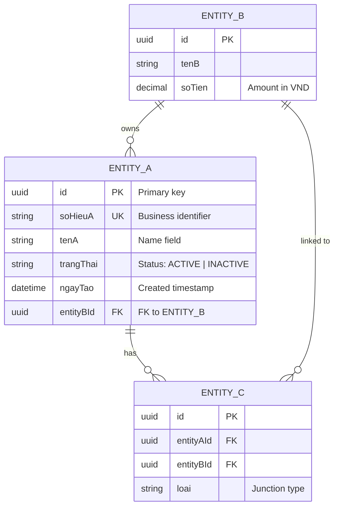

# Data Model: [Module Name]

> **Usage:** Describes the data entities, attributes, and relationships for a module.
> Keep synchronized with `docs/ba-data-model.md`. One file per module or sub-domain.

---

## Overview

| Field | Value |
|-------|-------|
| **Module** | [Module name — e.g. Quản Lý Hợp Đồng Vay] |
| **Linked FR** | FR-XXX, FR-YYY |
| **Linked URD** | Section X.X of [URD filename] |
| **Version** | v1.0 |
| **Created** | YYYY-MM-DD |
| **Status** | Draft / Review / Approved |

---

## Entity Relationship Diagram

> **Cardinality notation:**
> - `||--||` One to One (required)
> - `||--o|` One to One (optional)
> - `||--o{` One to Many (optional)
> - `||--|{` One to Many (required)
> - `}o--o{` Many to Many (both optional)

---

## Entity Definitions

### ENTITY_A — [Vietnamese Business Name]

**Mô tả:** [Vietnamese business description — what this entity represents in the domain]
**Loại:** Core Entity / Reference/Lookup / Junction/Bridge / Audit Log
**Table name:** `entity_a` (snake_case)

| Attribute | Type | Required | Constraints | Business Rule | Notes |
|-----------|------|----------|-------------|---------------|-------|
| `id` | UUID | Yes | PK, auto-generated | | |
| `soHieuA` | VARCHAR(50) | Yes | UNIQUE, NOT NULL | BR-XXX: format [A-Z]{2}-[0-9]{4} | Business identifier |
| `tenA` | VARCHAR(200) | Yes | NOT NULL | | Display name |
| `trangThai` | ENUM | Yes | NOT NULL | BR-YYY: state machine | ACTIVE / INACTIVE / PENDING |
| `ngayTao` | DATETIME | Yes | NOT NULL, DEFAULT NOW() | | Auto-set on insert |
| `ngayCapNhat` | DATETIME | Yes | NOT NULL | | Auto-update on any change |
| `entityBId` | UUID | Yes | FK → ENTITY_B.id | | |

**Indexes:**
- `idx_entity_a_trang_thai` on `(trangThai)` — for status-based queries
- `idx_entity_a_ngay_tao` on `(ngayTao)` — for date-range queries

---

### ENTITY_B — [Vietnamese Business Name]

**Mô tả:** [Description]
**Loại:** Core Entity
**Table name:** `entity_b`

| Attribute | Type | Required | Constraints | Business Rule | Notes |
|-----------|------|----------|-------------|---------------|-------|
| `id` | UUID | Yes | PK | | |
| `tenB` | VARCHAR(200) | Yes | NOT NULL | | |
| `soTien` | DECIMAL(18,2) | Yes | NOT NULL, CHECK(soTien >= 0) | BR-ZZZ | Amount in VND |

---

### ENTITY_C — [Junction Table Name] (ENTITY_A ↔ ENTITY_B)

**Mô tả:** [Why this junction exists — what relationship it represents]
**Loại:** Junction/Bridge
**Table name:** `entity_c`

| Attribute | Type | Required | Constraints | Business Rule | Notes |
|-----------|------|----------|-------------|---------------|-------|
| `id` | UUID | Yes | PK | | |
| `entityAId` | UUID | Yes | FK → ENTITY_A.id, NOT NULL | | |
| `entityBId` | UUID | Yes | FK → ENTITY_B.id, NOT NULL | | |
| `loai` | VARCHAR(50) | No | | | Junction type/role |

**Composite unique constraint:** `UNIQUE(entityAId, entityBId, loai)`

---

## Relationship Summary

| Entity A | Relationship | Entity B | Cardinality | Business Rule | Notes |
|----------|-------------|----------|-------------|---------------|-------|
| ENTITY_B | owns | ENTITY_A | One-to-Many (optional) | BR-XXX | |
| ENTITY_A | has | ENTITY_C | One-to-Many (optional) | | Junction |
| ENTITY_B | linked to | ENTITY_C | One-to-Many (optional) | | Junction |

---

## Business Rules (Data Level)

- **BR-XXX:** [Rule on data constraints — e.g. "soTien không được âm; nếu = 0 thì trangThai phải là INACTIVE"]
- **BR-YYY:** [State machine rule — e.g. "trangThai chỉ có thể chuyển: PENDING → ACTIVE → INACTIVE (không reversible)"]
- **BR-ZZZ:** [Referential integrity rule — e.g. "Không thể xóa ENTITY_B nếu có ENTITY_A đang ACTIVE reference đến nó"]

---

## Soft Delete Policy

| Entity | Hard Delete | Soft Delete | Audit Log |
|--------|------------|-------------|-----------|
| ENTITY_A | No | Yes (trangThai = DELETED) | Yes |
| ENTITY_B | No | Yes | Yes |
| ENTITY_C | Yes | No | No |

---

## Data Migration Notes

- [Nếu có data migration từ hệ thống cũ: ghi rõ mapping field cũ → field mới]
- [Transformation rules nếu có]
- [Data cleansing rules]

---

## Open Issues — Data Model

| Issue # | Entity | Field/Relationship | Question (VN) | Impact | Status |
|---------|--------|-------------------|--------------|--------|--------|
| DM-001 | ENTITY_A | `fieldName` | [Câu hỏi về field chưa rõ] | Không define được constraint | Open |
| DM-002 | ENTITY_A ↔ ENTITY_B | Relationship cardinality | [Câu hỏi về cardinality] | Sai ERD | Open |

---

## Change History

| Date | Changed By | Change |
|------|-----------|--------|
| YYYY-MM-DD | [BA Name] | Initial creation |
