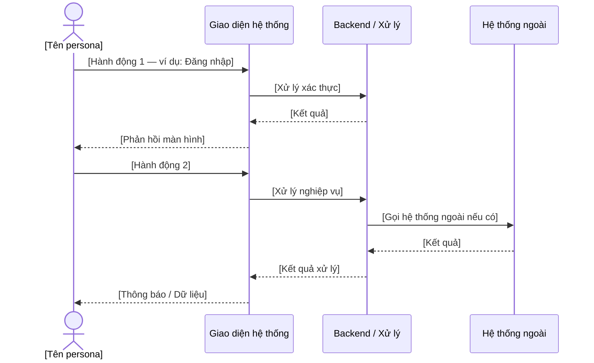
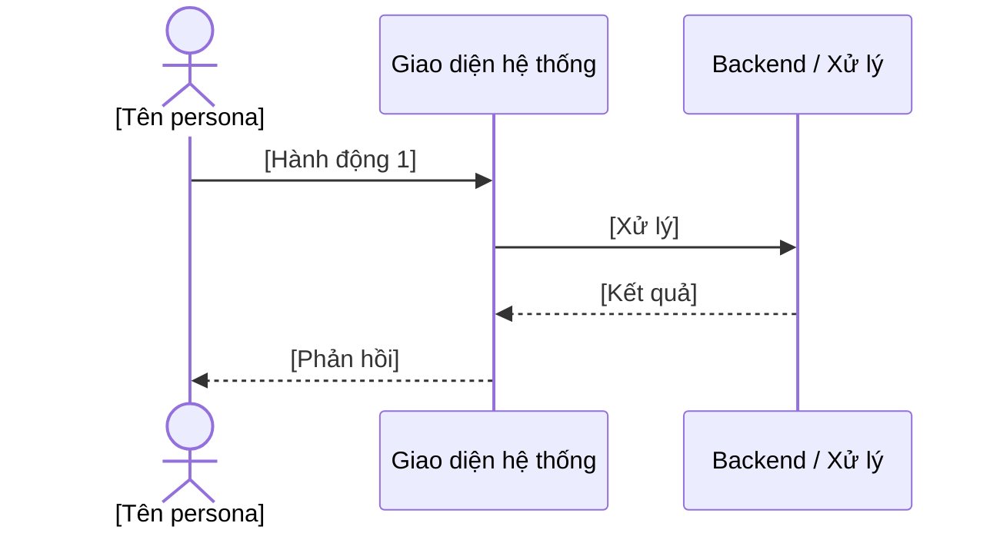

# Persona Card & User Journey Map

**Dự án:** [Tên dự án]  **Ngày tạo:** YYYY-MM-DD  **BA phụ trách:** [Tên BA]

> Lặp lại Section A–C cho mỗi persona. Đặt tên section: `## Persona 1`, `## Persona 2`, v.v.

---

## Persona 1: [Tên giả định — ví dụ: Nguyễn Thị Lan]

### A. Persona Card

| Thuộc tính | Chi tiết |
|-----------|---------|
| **Tên** | [Tên giả định tiếng Việt] |
| **Vai trò** | [Chức danh — ví dụ: Cán bộ tín dụng] |
| **Đơn vị** | [Đơn vị / Phòng ban] |
| **Mức độ am hiểu công nghệ** | Low / Medium / High |

**Mục tiêu sử dụng hệ thống:**
- [Mục tiêu 1]
- [Mục tiêu 2]
- [Mục tiêu 3]

**Khó khăn hiện tại:**
- [Pain point 1]
- [Pain point 2]
- [Pain point 3]

**Các thao tác chính trên hệ thống:**
- [Thao tác 1 — ví dụ: Tạo hồ sơ vay]
- [Thao tác 2]
- [Thao tác 3]

> *"[Câu nói đặc trưng thể hiện nhu cầu hoặc khó khăn của persona này]"*

---

### B. User Journey Map — Kịch Bản Chính

---

### C. Touch Points

| Giai đoạn | Hành động của người dùng | Điểm chạm hệ thống | Cảm xúc | Cơ hội cải thiện |
|-----------|------------------------|:-----------------:|:-------:|-----------------|
| [Giai đoạn 1] | [Hành động] | [Màn hình / API] | Trung tính | [Cơ hội] |
| [Giai đoạn 2] | [Hành động] | [Màn hình / API] | Tích cực | [Cơ hội] |
| [Giai đoạn 3] | [Hành động] | [Màn hình / API] | Tiêu cực | [Cơ hội cải thiện quan trọng] |
| [Giai đoạn 4] | [Hành động] | [Màn hình / API] | Tích cực | [Cơ hội] |

---

## Persona 2: [Tên giả định]

### A. Persona Card

| Thuộc tính | Chi tiết |
|-----------|---------|
| **Tên** | [Tên giả định tiếng Việt] |
| **Vai trò** | [Chức danh] |
| **Đơn vị** | [Đơn vị / Phòng ban] |
| **Mức độ am hiểu công nghệ** | Low / Medium / High |

**Mục tiêu sử dụng hệ thống:**
- [Mục tiêu 1]
- [Mục tiêu 2]

**Khó khăn hiện tại:**
- [Pain point 1]
- [Pain point 2]

**Các thao tác chính trên hệ thống:**
- [Thao tác 1]
- [Thao tác 2]

> *"[Câu nói đặc trưng]"*

---

### B. User Journey Map — Kịch Bản Chính

---

### C. Touch Points

| Giai đoạn | Hành động của người dùng | Điểm chạm hệ thống | Cảm xúc | Cơ hội cải thiện |
|-----------|------------------------|:-----------------:|:-------:|-----------------|
| [Giai đoạn 1] | [Hành động] | [Màn hình / API] | Trung tính | [Cơ hội] |
| [Giai đoạn 2] | [Hành động] | [Màn hình / API] | Tích cực | [Cơ hội] |
