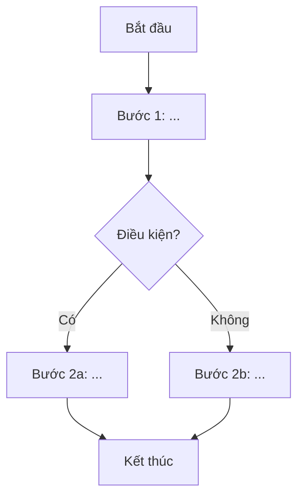

# Phân Tích Quy Trình: AS-IS vs TO-BE

**Tên quy trình:** [Tên quy trình nghiệp vụ]
**Module:** [Tên module hệ thống]
**Ngày phân tích:** YYYY-MM-DD
**BA phụ trách:** [Tên BA]

---

## A. Quy Trình Hiện Tại (AS-IS)

### Mô Tả Quy Trình

| Bước | Người thực hiện | Mô tả hành động | Công cụ / Hệ thống | Điểm khó khăn |
|:----:|----------------|----------------|-------------------|--------------|
| 1 | [Actor] | [Hành động] | [Tool/System] | [Pain point nếu có] |
| 2 | [Actor] | [Hành động] | [Tool/System] | [Pain point nếu có] |
| 3 | [Actor] | [Hành động] | [Tool/System] | [Pain point nếu có] |

### Sơ Đồ Quy Trình AS-IS

---

## B. Quy Trình Mới (TO-BE)

### Mô Tả Quy Trình Cải Tiến

| Bước | Người thực hiện | Mô tả hành động | Công cụ / Hệ thống | Cải tiến so với AS-IS |
|:----:|----------------|----------------|-------------------|--------------------|
| 1 | [Actor] | [Hành động] | [Tool/System] | [Điểm cải tiến] |
| 2 | [Actor] | [Hành động] | [Tool/System] | [Điểm cải tiến] |
| 3 | [Actor] | [Hành động] | [Tool/System] | [Điểm cải tiến] |

### Sơ Đồ Quy Trình TO-BE

---

## C. Phân Tích Khoảng Cách (Gap Analysis)

| Gap-ID | Mô tả khoảng cách | AS-IS | TO-BE | Loại cải tiến | Độ ưu tiên |
|--------|------------------|-------|-------|:-------------:|:----------:|
| GAP-001 | [Mô tả] | [Hiện trạng] | [Trạng thái mong muốn] | Tự động hóa | P1 |
| GAP-002 | [Mô tả] | [Hiện trạng] | [Trạng thái mong muốn] | Đơn giản hóa | P2 |
| GAP-003 | [Mô tả] | [Hiện trạng] | [Trạng thái mong muốn] | Loại bỏ thủ công | P1 |

**Loại cải tiến:** Tự động hóa / Đơn giản hóa / Loại bỏ thủ công / Tăng cường kiểm soát / Cải thiện trải nghiệm

---

## D. Tác Động Dự Kiến

- **Tiết kiệm thời gian:** [Ước tính thời gian giảm/bước]
- **Giảm rủi ro nghiệp vụ:** [Rủi ro được loại bỏ hoặc giảm thiểu]
- **Cải thiện trải nghiệm người dùng:** [Mô tả cụ thể]
- **Chỉ số đo lường (KPI):** [Chỉ tiêu đo lường kết quả sau khi triển khai]
