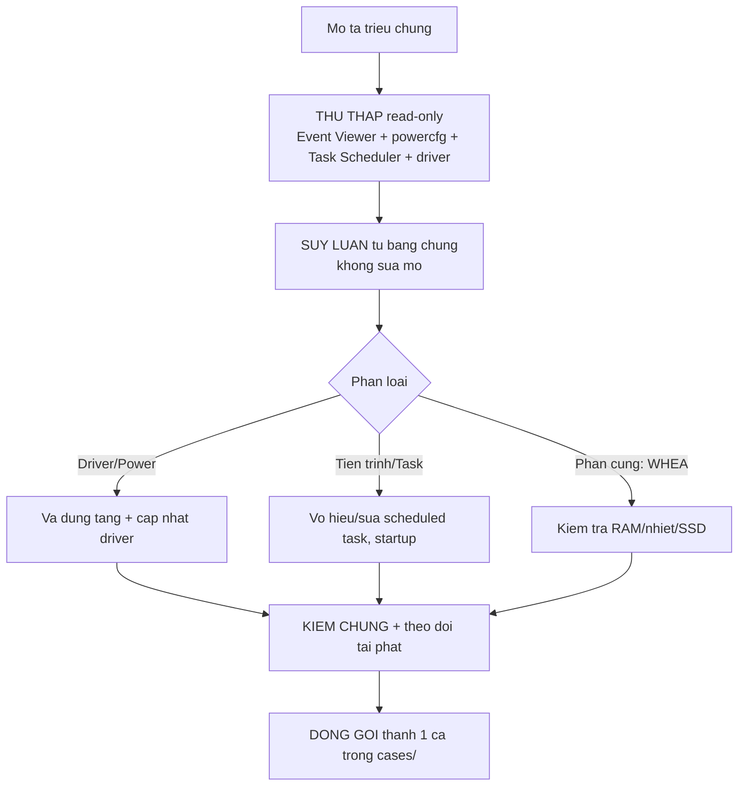

# Skill: Tìm & Fix Lỗi Windows (Thư Viện Đa-Ca)

Thư viện tích lũy mọi ca điều tra/khắc phục lỗi Windows. Mỗi lần xử lý xong một sự
cố, đóng gói thành 1 ca trong `cases/` để lần sau dùng lại.

## Cách gọi skill
Gõ `/windows_fix` trong Claude Code (chạy trong thư mục `08_Tim_Loi_Windows` hoặc
project cha). Tên thư mục skill = lệnh gọi.

## Quy ước thư mục
```
08_Tim_Loi_Windows/
└── .claude/skills/windows_fix/      # ← skill (Claude tu nhan dien)
    ├── SKILL.md                  # File này - chỉ mục + phương pháp luận chung
    ├── README.md                 # Tổng quan thư viện
    └── cases/                    # Mỗi sự cố = 1 thư mục con
        ├── <ten-ca>/
        │   ├── README.md         # Triệu chứng + cách dùng nhanh
        │   ├── scripts/          # Script chẩn đoán / fix / hoàn tác
        │   └── *.md / *.csv      # Báo cáo nguyên nhân, log thu thập
        └── ...
```

## Danh mục các ca (cases)
| Ca | Triệu chứng | Trạng thái |
|---|---|---|
| [`treo-ngu-sau-modern-standby`](cases/treo-ngu-sau-modern-standby/README.md) | Máy treo/ngủ sâu khi idle, đèn nguồn nhấp nháy, không wake, phải giữ nút nguồn | ✅ Đã giải quyết — bộ script đầy đủ |
| [`terminal-nhay-watchdog`](cases/terminal-nhay-watchdog/README.md) | Cửa sổ Terminal/PowerShell nhấp nháy bật-tắt liên tục | ✅ Đã giải quyết — scheduled task |
| [`tu-dong-restart-va-startup-apps`](cases/tu-dong-restart-va-startup-apps/README.md) | Windows tự restart lúc 4AM mỗi CN; sau restart startup apps không tự chạy | ✅ Đã phân tích — 4 nguyên nhân, bộ script đầy đủ |
| [`parsec-p2p-connection-failed`](cases/parsec-p2p-connection-failed/README.md) | Parsec lỗi P2P [-6023/-6024/-11010], service bị stop, firewall block | ✅ Đã giải quyết — service + firewall + watchdog |
| [`loi-phim-ctrl-nghi-hook-phan-mem`](cases/loi-phim-ctrl-nghi-hook-phan-mem/README.md) | Phím Ctrl (trái) bấm không ăn, phải bấm lại nhiều lần, không do bàn phím vật lý | 🔍 Đang theo dõi — đã fix USB power management cho bàn phím built-in (nghi phạm chính), đã sửa 2 bug ở SwapInsHome (không phải nguyên nhân), UniKey là nghi phạm phụ |

## Phương pháp luận chung (áp dụng mọi ca)


**4 nguyên tắc:**
1. **Chẩn đoán trước, sửa sau** — luôn chạy bước thu thập read-only trước.
2. **Suy luận từ bằng chứng** — Event Viewer/Task Scheduler kể toàn bộ câu chuyện;
   chú ý "khoảng lặng" trong log = dấu hiệu HANG.
3. **Vá đúng tầng** — cấu hình theo gói nguồn dễ bị đảo ngược; ưu tiên tầng nền tảng.
4. **Hoàn tác được** — mọi thay đổi đều có đường lùi; tự xin UAC khi cần.

## Cách thêm 1 ca mới (khi xử lý xong sự cố mới)
1. Tạo `cases/<ten-ca-kebab>/` + `scripts/` bên trong.
2. Lưu script chẩn đoán (read-only) và script fix (tự xin UAC, hoàn tác được).
3. Viết `README.md` của ca: triệu chứng nhận biết + cách dùng nhanh.
4. Lưu báo cáo nguyên nhân (`.md`/`.txt`) + log thu thập (`.csv`).
5. Thêm 1 dòng vào bảng "Danh mục các ca" ở trên.

## Nguồn công cụ thường dùng
- `powercfg /a`, `powercfg /query`, `powercfg /list` — trạng thái & cấu hình nguồn.
- `Get-WinEvent` (System/Application log) — Kernel-Power 41/42/506/507, WHEA, BugCheck.
- `Get-ScheduledTask` / `schtasks` — tác vụ chạy ngầm bất thường.
- `Get-CimInstance Win32_PnPSignedDriver` — phiên bản driver.
