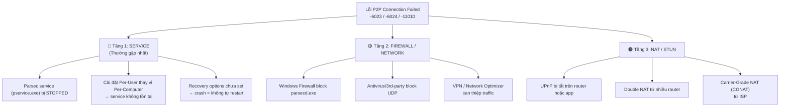

# Phân tích nguyên nhân gốc (Root Cause Analysis)
**Case: Parsec P2P Connection Failed [-6023 / -6024 / -11010]**

Qua nghiên cứu tài liệu chính thức của Parsec và thực tế, lỗi P2P connection failed có **3 tầng nguyên nhân**.

## Ý nghĩa Error Codes
- **-6023**: Quá trình thương lượng STUN / NAT traversal thất bại. Giao thức UDP bị chặn trên đường đi (thường gặp nhất).
- **-6024**: Máy khách (Client) không thể kết nối đến host do firewall trên máy khách chặn kết nối UDP inbound.
- **-11010 / -11011**: Lỗi timeout hoặc UPnP bị tắt. Host/Client không tìm được đường đi P2P direct.

## Cơ chế tái phát (Tại sao sửa xong lại bị?)

1. **Parsec Service Crash im lặng**: Do thiếu cấu hình Recovery trong Windows Services, khi `pservice.exe` gặp lỗi và dừng lại, nó không tự động khởi động lại.
2. **Windows Update**: Một số bản cập nhật hoặc khởi động lại máy có thể làm chậm quá trình khởi động service, gây timeout.
3. **Firewall Reset**: Một số Antivirus hoặc Windows Security tự động xóa/vô hiệu hóa inbound rules của các ứng dụng lạ sau một thời gian.

## Giải pháp triển khai
Bộ script được thiết kế để vá tất cả các lỗ hổng trên:
- `2-fix-service-layer.ps1`: Vá lỗi ở mức hệ điều hành, cấu hình Recovery khởi động lại service sau 5s, 10s, 30s.
- `3-fix-firewall-layer.ps1`: Tái tạo rules tường lửa chuẩn (TCP 443 inbound, UDP 3478 STUN, UDP 8000-8010 P2P, và Any Outbound).
- `5-watchdog-parsec-service.ps1`: Lớp bảo vệ thứ 2, chạy liên tục bằng Scheduled Task mỗi 5 phút để đảm bảo service luôn sống.
