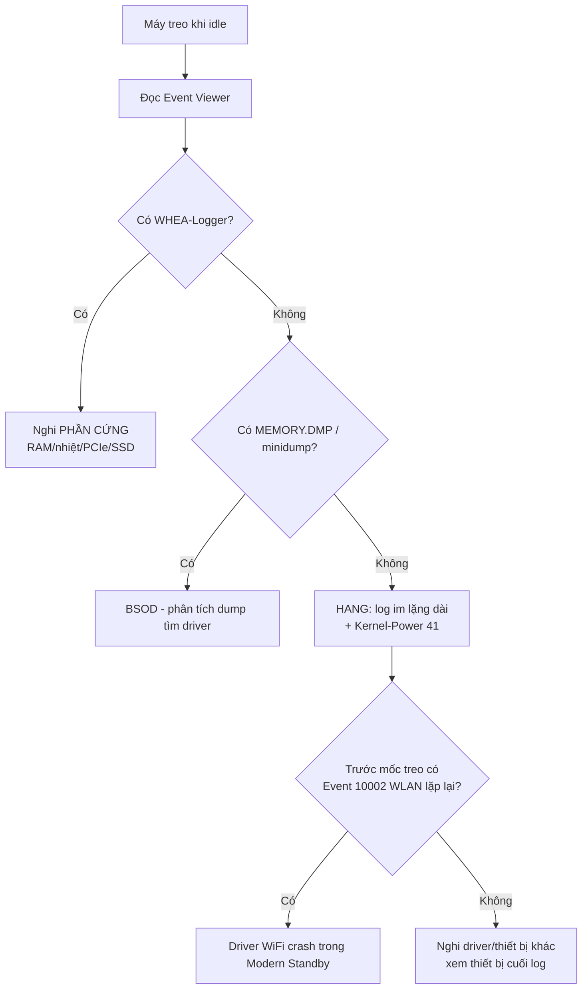

# Playbook: Chẩn Đoán Máy Treo / Ngủ Sâu Không Đánh Thức (Modern Standby)

Tài liệu phương pháp luận + ca thật làm mẫu. Đọc để hiểu **cách suy luận**, không
chỉ chạy script.

---

## 1. Bản chất vấn đề

Laptop Windows 11 đời mới thường **chỉ có Modern Standby (S0 Low Power Idle / S0ix)**,
firmware đã bỏ chế độ ngủ cũ S3. Trong Modern Standby, máy vẫn "thức nhẹ": CPU hạ
sâu nhưng nhiều thiết bị (WiFi, USB...) vẫn được quản lý điện. Nếu một **driver lỗi
khi chuyển trạng thái điện** (điển hình driver WiFi), nó có thể **deadlock** cả tiến
trình resume → máy kẹt, không đánh thức được, đèn nguồn nhấp nháy → phải tắt cứng.

Vì không có S3/hibernate để "thoát hiểm", khi S0ix kẹt là treo hẳn.

---

## 2. Quy trình chẩn đoán (suy luận từ bằng chứng)

### Các nguồn bằng chứng (Event Viewer - System log)
| Dấu hiệu | Ý nghĩa |
|---|---|
| **Kernel-Power 41** | Máy tắt không sạch (treo/mất điện). Đếm số lần, ghi mốc giờ. |
| **Không có MEMORY.DMP + không minidump** + khoảng lặng log dài | = **HANG** (treo cứng, không kịp ghi dump). Khớp "giữ nút nguồn". |
| **WHEA-Logger** (bất kỳ) | Nghi **lỗi phần cứng** → đổi hướng (memtest, nhiệt độ, SSD). |
| **BugCheck 1001** | Có BSOD → đọc mã lỗi (vd 0x7E, 0xc0000005 = driver access violation). |
| **WLAN-AutoConfig 10002** "WLAN Extensibility Module has stopped" | Driver WiFi crash. Nếu **dồn dập trước mốc Kernel-Power 41** = thủ phạm. |
| **Kernel-Power 506/507** | Vào/ra Modern Standby. 507 thiếu sau 506 = kẹt khi đang ngủ. |
| **powercfg /a** chỉ có "S0 Low Power Idle" | Máy dùng Modern Standby → đối tượng dễ dính lỗi này. |

### Mẹo phát hiện "HANG": tìm khoảng lặng
Lấy các sự kiện ngay **trước** mốc Kernel-Power 41. Nếu thấy log dừng hẳn nhiều
giờ rồi mới tới mốc reboot → máy đã treo từ thời điểm log dừng. Sự kiện **cuối cùng
trước khoảng lặng** thường chỉ ra thủ phạm (vd: WLAN module stopped).

---

## 3. Hướng khắc phục (theo nguyên nhân)

### 3a. Driver WiFi crash trong Modern Standby (phổ biến nhất trên laptop)
Hai mũi, làm cả hai để chắc:
1. **Chặn đường (bền, làm ngay):** Tắt hẳn Modern Standby ở tầng registry
   `HKLM\SYSTEM\CurrentControlSet\Control\Power\PlatformAoAcOverride = 0` (DWORD).
   Sau reboot, `powercfg /a` sẽ báo S0ix **not available** → máy không vào được
   trạng thái gây treo nữa. **Quan trọng:** đây là tầng nền tảng → KHÔNG bị đảo
   ngược khi Windows đổi gói nguồn (đây là lý do cách "đặt sleep = never" thất bại).
2. **Chữa gốc:** Cập nhật driver WiFi lên bản mới nhất từ hãng máy.

### 3b. Tại sao KHÔNG nên chỉ "đặt không bao giờ ngủ"
`powercfg /change standby-timeout-* 0` chỉ áp cho **gói nguồn đang active**. Windows/
Lenovo Vantage có thể **đổi gói nguồn** (vd Ultimate → High Performance) → gói mới
vẫn ngủ sau X phút → tái phát. Vì vậy phải vá tầng nền tảng (mục 3a).

### 3c. Nghi phần cứng (có WHEA)
Không thuộc phạm vi skill này. Kiểm tra: memtest86 (RAM), nhiệt độ (HWiNFO),
SMART của SSD, cập nhật BIOS.

---

## 4. CA THẬT LÀM MẪU (06/2026)

**Máy:** Lenovo ThinkBook 14 G5+ ARP (21HY), Ryzen 7 7735H, Win11 Pro Workstations
build 26200, WiFi MediaTek MT7921.

**Triệu chứng:** để idle/khóa qua đêm → treo, đèn nguồn nhấp nháy, không wake → sáng
phải giữ nút nguồn tắt.

**Bằng chứng đọc được:**
- 3 lần Kernel-Power 41 (treo) trong ~2 tháng.
- **Không** có WHEA → loại trừ phần cứng.
- **Không** có MEMORY.DMP/minidump cho các lần treo → là HANG.
- Trước mốc treo: **Event 10002 (mtkihvx.dll - driver WiFi MediaTek) lặp 4 lần**,
  lần cuối ~2 phút trước khi treo. Đêm tái phát: 05:43 module started → 05:44
  stopped → **log im lặng ~2h49p** → 08:33 Kernel-Power 41 (user tắt cứng).
- `powercfg /a`: chỉ có S0 Low Power Idle (Modern Standby), không S3, hibernate off.
- Driver WiFi: bản cũ **v23.32.2.558 (2023-05-23)**.

**Diễn biến fix:**
1. *Lần 1 (thất bại):* đặt never-sleep trên gói "Ultimate Performance". Vài ngày
   sau Windows đổi sang "High performance" (vẫn ngủ sau 10 phút) → **tái phát**.
   → Bài học: phải vá tầng nền tảng.
2. *Lần 2 (thành công):* `PlatformAoAcOverride=0` + never-sleep mọi gói nguồn →
   reboot → `powercfg /a` báo S0ix **not available**. Máy hết treo.
3. *Chữa gốc:* cập nhật driver WiFi lên **v25.40.2.586 (2026-01-30)**.

**Kết quả:** vừa chặn đường (tắt Modern Standby) vừa chữa gốc (driver mới). Hết treo
kể cả khi chạy pin / bật tiết kiệm pin (vì bản vá độc lập với chế độ/gói nguồn).

---

## 5. Bài học rút ra
1. **Chẩn đoán bằng bằng chứng, không sửa mò.** Event Viewer kể toàn bộ câu chuyện.
2. **Khoảng lặng trong log = dấu vân tay của HANG.** Sự kiện cuối trước đó là manh mối.
3. **Vá phải ở đúng tầng.** Cấu hình theo gói nguồn dễ bị đảo ngược; tầng registry
   nền tảng mới bền.
4. **Chặn đường + chữa gốc** song song cho chắc (tắt Modern Standby + cập nhật driver).
5. **Sau update BIOS/Windows lớn**, kiểm chứng lại vì bản vá registry có thể bị reset.

---

## Câu hỏi còn mở (chung cho loại lỗi này)
- Bản vá `PlatformAoAcOverride` có thể bị xóa bởi BIOS update / Windows feature
  update lớn → cần kiểm chứng định kỳ.
- Nếu firmware máy **có** S3, cân nhắc cho phép ngủ S3 thay vì tắt hẳn ngủ (tùy nhu cầu).
- Máy hãng khác (không Lenovo): script cập nhật driver/BIOS phần "tự động tải" có
  thể không khớp; dùng phương thức "mở web"/"cài từ file".
