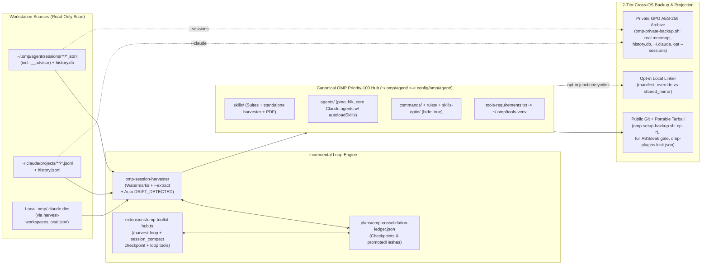

# OMP Ecosystem V3 Consensus Design & Hardening Audit

> **Public Repo Safety:** All local workstation paths and private client identifiers are omitted or generalized. Machine-specific workspace maps and redaction terms live exclusively in `~/.omp/harvest-workspaces.local.json`.

---

## 1. Executive Summary & Verified Workstation Ground Truth

While `zuey-pi-setup` already holds the V2 baseline on disk (`12` Priority-100 skills, `131` `skills-optin`, `11` agents, `4` commands, `3` rules, `tools-venv`, and 2-tier Public/GPG backup scripts), the working tree is currently **dirty & uncommitted** following an incomplete sanitization cutover, and deep auditing surfaced concrete contract defects, missing global parity, and cross-OS/loop limitations.

### Verified Workstation & Repo Inventory (`2026-11-10`)
| Surface | Verified Fact on Disk | Key Gap / Risk |
|---|---|---|
| **OMP Runtime** | `omp v18.18.6` (`--from-claude`, `--continue`, `--resume`, `--restore`, `--goal`, `-e/--extension`) | Supports native session import, loop continuation, and in-process TS extension tools/hooks |
| **OMP Sessions** | `129` `.jsonl` (`44` top, `23` subagent, `62` `__advisor.jsonl`); `history.db`: `1,426` prompts / `489` sessions / `43` CWDs; `stats.db`: `21,544` tool calls; `69` `mnemopi.db` banks | `62` advisor transcripts skipped; older transcripts pruned beyond `sessions/`; `~20` scratch/test `mnemopi` banks pollute GPG backups |
| **Claude Sessions** | `274` `.jsonl` (`40` top, `232` subagents, `2` journals) across `10` project dirs; `127` `history.jsonl` lines; `14` `memory/*.md` | Not archived optionally in private backup (`--sessions`) |
| **Local `.omp`/`.claude` Dirs** | `~74` distinct non-backup/non-scratch dirs + `~210+` backup/worktree/scratch dirs; `5` junctions/symlinks + `1` TS re-export shim | `scan_global_diff` misses root-level junctions (`<proj>/.omp/rules`); no manifest separating overrides vs linkable shared mirrors |
| **Global `~/.claude` Parity** | `18` of `19` agents, `6` rules, `4` JS workflows, `34` `.cjs` hooks (+ `lib/`), `typesafe` MCP, `85+` CK skills + `document-skills/` | Missing from `config/omp/agent/` if a new Mac runs `omp-setup-restore.sh` without Tier-2 `--claude` GPG |
| **Dirty V2 Cutover Defects** | `config/harvest-workspaces.json` emptied -> `~/.omp/harvest-workspaces.local.json` created | `omp-session-harvester.py` & `omp-promote-assets.py` do NOT load `harvest-workspaces.local.json`; `_PRIV_PAT` in `omp-promote-assets.py` is unused; residual literals in `plans/`, `tests/`, `scripts/` |
| **Standalone Skill Packaging** | `config/omp/agent/skills/omp-session-harvester/scripts/harvest_cli.py` | Thin wrapper fails with `FileNotFoundError` on any restored machine without `zuey-pi-setup` repo |
| **Cross-OS PDF / `.mpp`** | `office-doc-suite` `to_md` uses external `pdftotext`; `pmo-project-suite` `mpp2xml` uses Windows COM | Fresh macOS fails on `.pdf` without Poppler and cannot inspect binary `.mpp` without Windows export/bridge |

---

## 2. Systematic Problem-Solving Analysis (`ck:problem-solving`)

1. **Simplification Cascade ("One Canonical Hub, Many Projections"):**
   - Instead of synchronizing 74 scattered `.omp`/`.claude` directories directly or committing fragile NTFS junctions into Git/tarballs, collapse shared assets into **one canonical Priority-100 hub (`~/.omp/agent/` mirrored in `config/omp/agent/`)**, materialized cleanly (`cp -rL`) for cross-OS transport, and projected back to eligible local workspaces via an opt-in manifest linker.
2. **Meta-Pattern Recognition (4 Suites + 1 Loop Engine):**
   - Repeated session work collapses into 4 domain CLIs (`pmo-project-suite`, `office-doc-suite`, `email-intelligence-suite`, `system-maintenance-suite`) sharing a uniform **Dual-Mode CLI + `venv_bootstrap.py` + `--json` contract**, plus 1 standalone **Harvester Loop Engine** (`omp-session-harvester`) tracking watermarks across sessions.
3. **Inversion Exercise ("What breaks if a new macOS/Windows machine has ONLY `~/.omp`?"):**
   - Inverting the current reliance on `skills.enableClaudeUser: true` exposes two failures: `omp-session-harvester` crashes outside the repo, and `18` core agents + `6` rules + PDF extraction disappear unless Tier-2 `--claude` + Poppler are also installed. Fix: make `config/omp/agent/` self-sufficient for core agents/rules, standalone harvester execution, and pure-Python PDF.
4. **Scale Game (`1,000+` sessions, `150+` skills, multi-round runs):**
   - Current $O(N)$ re-scans with 200-char previews and frozen `COMPLETED` status fail at scale. Solution: per-file `mtime + size + sha256` watermarks (`O(delta)`), persisted hash->source index + `--extract <hash>`, and automatic `COMPLETED -> DRIFT_DETECTED` state transitions.

---

## 3. Multi-Persona Pre-Analysis (`ck:predict`)

**Verdict: `GO WITH STRICT GATES` (`CAUTION` on dirty-tree cleanup & bulk kit restraint)**

### Agreements Across Personas
- **Unanimous:** Repair the broken `harvest-workspaces.local.json` loader, `_PRIV_PAT` invocation, residual repo leaks, and standalone `omp-session-harvester` packaging **before** expanding scope or committing.
- **Unanimous:** Reject bulk-porting foreign kits (third-party RuFlo/BMAD/APEX/marketing kit commands and agents) to avoid prompt bloat, namespace collisions, and maintenance debt.

### Conflicts & Resolutions
| Topic | Architect | Security | Performance | UX | Devil's Advocate | Consensus Resolution |
|---|---|---|---|---|---|---|
| **Local `.omp`/`.claude` Symlinks** | Clean canonical source of truth | Symlinks must never enter Git/tarball | Avoid scanning duplicate trees repeatedly | Zero broken links on existing project repos | `auto-replace` risks mutating active repos | **`manifest_optin_link`**: Promote unique assets to global; classify local dirs (`override` vs `shared_mirror`); opt-in local link CLI; `cp -rL` on backup |
| **OMP Packaging Primitive** | Native extension hooks solve cross-session continuity | Extension stays inside `~/.omp/agent/extensions/` | No persistent MCP daemon overhead | Keep dual-mode TTY + `--json` CLIs in skills | Pure skills already handle 90% without TS code | **`hybrid_skills_plus_thin_ext`**: Keep Skills + `tools-venv` + Agents (`autoloadSkills`); add 1 thin extension (`extensions/omp-toolkit-hub.ts`) for `/harvest-loop`, loop tools, and `session_compact` checkpointing |
| **PDF & `.mpp` on macOS** | Pure Python eliminates external binary breaks | `pypdf`/`pdfplumber` avoid shell-injection paths | Small wheel footprint in `tools-venv` | `to-md` works out of the box on macOS | Binary `.mpp` has no pure-Python parser | Add `pypdf` / `pdfplumber` to `tools-requirements.txt`; keep `.mpp` explicit: Windows COM (`--use-com`) + clear macOS `.xml` / optional `mpxj` CLI bridge guidance |

---

## 4. Edge-Case & Failure-Mode Matrix (`ck:scenario`)

*(Analyzed dimensions: Input Extremes, Timing, Scale, State Transitions, Environment, Error Cascades, Data Integrity, Compliance/Privacy; skipped User Types, Authorization, Business Logic as single-owner local CLI.)*

| # | Dimension | Scenario | Severity | Required Behavior / Guard |
|---|---|---|---|---|
| 1 | **Compliance / Privacy** | `config/harvest-workspaces.json` emptied while `omp-session-harvester.py` / `omp-promote-assets.py` ignore `harvest-workspaces.local.json`, or `_PRIV_PAT` is uncalled | **Critical** | Both scripts deep-merge `~/.omp/harvest-workspaces.local.json` (when using default config unless `--no-local-config` for tests); `sanitize_content()` enforces `_PRIV_PAT` before any write; `omp-setup-backup.sh` extends `ABS_LEFT` + leak scan across ALL `agent/` subdirs (`skills/`, `agents/`, `rules/`, `commands/`, `extensions/`). |
| 2 | **Data Integrity** | Active OMP session `.jsonl` locked on Windows (`WinError 32`) during incremental scan | **High** | Harvester reads `.jsonl` with shared retry/skip-with-warning without aborting batch or advancing watermark for unreadable files. |
| 3 | **State Transitions** | Multi-round loop reaches `COMPLETED`, then new sessions or new local skills appear in round `N+1` | **High** | Ledger compares current `fileWatermarks`, `promotedHashes`, and `globalDiffSummary` on `--scan`; any new unpromoted cluster or delta automatically flips suite/ledger status to `DRIFT_DETECTED` and surfaces via `--next`. |
| 4 | **Environment (Cross-OS)** | Restored `omp-session-harvester` skill invoked on fresh macOS without repo clone | **Critical** | Self-contained harvester library lives inside `config/omp/agent/skills/omp-session-harvester/scripts/` (or synced single source), zero repo-path requirement. |
| 5 | **Environment (macOS Node/Path)** | Private restore `--claude` on macOS using `nvm`/`fnm`/`volta`/`mise` where `node` is not in `/opt/homebrew/bin` | **High** | Probe login shell `PATH`, `~/.nvm/versions/node/*/bin/node`, `~/.fnm/...`, `/opt/homebrew/bin/node`, `/usr/local/bin/node` cleanly; preserve executable bits. |
| 6 | **Scale / Disk Bloat** | `mnemopi/banks/` contains `~20` ephemeral test banks (`omp-verify-workspace-*`, `scratch-*`, `a-*`, `ck-smoke-*`) | **Medium** | `omp-private-backup.sh` adds `--prune-test-banks` / default filter skip pattern (overridable with `--include-scratch-banks`), keeping real workspace banks intact. |
| 7 | **Data Integrity** | Local workspace junction (`<local-project>/.omp/rules`) points at directory level rather than child entries | **Medium** | `scan_global_diff()` checks `is_reparse_or_symlink()` on the subdirectory container (`skills`, `agents`, `commands`, `rules`) itself as well as its children. |
| 8 | **Input Extremes** | Scanned PDF on macOS lacks `pdftotext` (`Poppler`) | **High** | `office_cli.py to-md` tries pure-Python `pypdf` / `pdfplumber` first (installed in `tools-venv`), falling back to `pdftotext` only if needed; graceful structured error if encrypted/image-only. |

---

## 5. Agreed Target V3 Architecture

### Concrete V3 Workstreams (Consensus Scope)
1. **Workstream A — Immediate Dirty-Tree & Contract Repair (`fix_core_and_leaks`):**
   - Deep-merge `~/.omp/harvest-workspaces.local.json` in both `omp-session-harvester.py` and `omp-promote-assets.py` (with `--no-local-config` isolation flag for tests).
   - Wire `_PRIV_PAT` inside `omp-promote-assets.py:sanitize_content()`.
   - Scrub remaining hardcoded internal project/client/path literals from `scripts/omp-session-harvester.py`, `tests/test-omp-session-harvester.sh`, `config/omp/agent/managed-skills/zuey-omp-backup-workflow/SKILL.md`, and `plans/`.
   - Extend `omp-setup-backup.sh` path/leak verification (`ABS_LEFT`) across ALL `agent/` directories (`skills/`, `skills-optin/`, `agents/`, `commands/`, `rules/`, `managed-skills/`, `extensions/`), and preserve `omp-plugins.lock.json` alongside `package.json`.
   - Package `omp-session-harvester` standalone inside `config/omp/agent/skills/omp-session-harvester/` (no repo CWD requirement).
2. **Workstream B — Incremental Multi-Round Harvester & Thin OMP Extension (`incremental_watermark_registry` + `hybrid_skills_plus_thin_ext`):**
   - Add per-file `fileWatermarks` (`mtime_ns`, `size`, `sha256`), `promotedHashes` registry, `--extract <hash> --out <dir>` source recovery from `.jsonl`, configurable `__advisor` inclusion (`--include-advisors`), Windows locked-file retry, container-level symlink detection (`scan_global_diff`), and automatic `DRIFT_DETECTED` reopening.
   - Build thin `extensions/omp-toolkit-hub.ts` (slash command `/harvest-loop`, loop checkpoint inspection/advance tool, `session_compact` state preservation, optional PM/BA write-guard hook parity).
3. **Workstream C — Global Claude Core Parity & Opt-In Workspace Linker (`port_global_claude_agents_rules` + `manifest_optin_link`):**
   - Port global `~/.claude/agents/` (`18` agents), `~/.claude/rules/` (`6` rules), workflow commands/guides (`4` workflows), and PM/BA `pre-write` rules/hooks into `config/omp/agent/` (preserving OMP frontmatter & `autoloadSkills`).
   - Add local workspace classification manifest (`override` vs `shared_mirror` vs `archive`) in `~/.omp/harvest-workspaces.local.json` + safe opt-in linker CLI (`omp-link-local`) that links eligible local mirrors back to `~/.omp/agent/` without touching Git/tarballs (`cp -rL` always materializes).
4. **Workstream D — Cross-OS PDF/MPP & Private Backup Hygiene (`pdf_pure_python_and_mpp_mac` + `clean_mnemopi_and_session_archive`):**
   - Add `pypdf` (or `pdfplumber`) to `config/omp/agent/tools-requirements.txt` and wire pure-Python PDF text/table fallback into `office-doc-suite` `doc_converter.py` (`to-md`), plus documented `.mpp` macOS fallback (`msp` XML export / optional `mpxj` wrapper).
   - Filter ephemeral test `mnemopi` banks by default in `omp-private-backup.sh`, add opt-in `--sessions` flag to snapshot compressed OMP/Claude transcripts outside Git, and harden `nvm`/`fnm`/`volta`/Bun `node` resolution in `omp-private-restore.sh`.

---

## 6. Success Metrics & Next Steps
- **Zero Public Leaks:** `git diff --cached` + tarball scan pass 0 tokens, 0 `.db*`, 0 symlinks, 0 `C:/Users`/`D:/` or internal project strings across ALL tracked/staged files.
- **100% Standalone Skill Portability:** Restored target (Windows & macOS) runs all 5 suites (`pmo`, `office`, `email`, `maintenance`, `harvester`) + pure-Python PDF without repo checkout or Poppler.
- **Resumable Multi-Round Loop:** Running `/harvest-loop` or `harvest_cli.py --scan --next` across sessions scans only changed files (`O(delta)`), extracts full utilities on demand, and resumes cleanly across compaction.
- **Next Step:** Await user confirmation to generate the detailed V3 implementation plan (`/ck:plan`) and first commit/stabilize the pending V2 changes cleanly.
