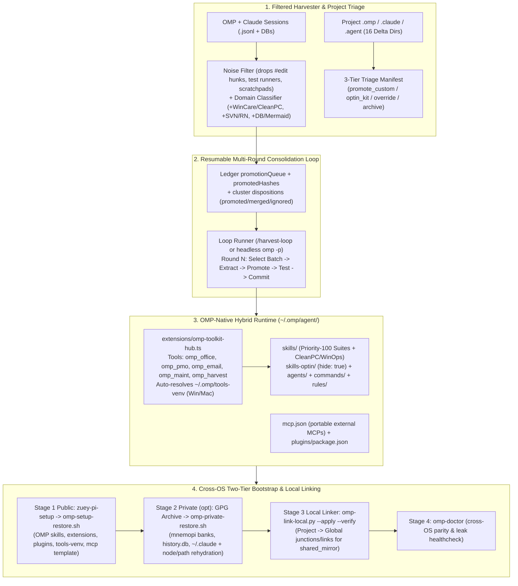

# OMP Ecosystem V4 Architecture Brainstorm

## 1. Problem Statement & Verified Workstation Baseline

Despite V3 shipping a solid foundation (`4` consolidated Python domain suites + `omp-session-harvester` under `config/omp/agent/skills/`, `omp-toolkit-hub.ts`, `omp-link-local.py`, and split Public/GPG backup-restore scripts), live workstation inspection (`2026-11-10`) exposed **five structural gaps** blocking frictionless reuse across sessions and Windows/macOS machines:

| Surface | Verified Live State on Disk | Root Friction / Gap |
|---|---|---|
| **OMP Runtime & Native Capability Surface** | `omp v18.18.6` supports `extensions/` (`pi.registerTool`), `skills/` (`SKILL.md` + `hide: true`), `agents/` (`autoloadSkills`), `rules/` (incl. TTSR), `commands/`, `mcp.json`, and `agent-plugins` (`plugin.json` / `omp.extensions`) | 4 domain suites (`office-doc`, `pmo-project`, `email-intelligence`, `system-maintenance`) remain passive `SKILL.md` + Python CLI scripts; `omp-toolkit-hub.ts` exposes only `omp_harvest_status` and `omp_extract_cluster`. Every session still guesses script paths and `~/.omp/tools-venv` interpreter per OS. |
| **Harvester Signal-to-Noise & Ledger Accounting** | `omp-harvester-cache.json` indexes `1,896` clusters (`2,858` artifacts across `68` OMP + `274` Claude sessions); `1,758` clusters (`2,243` artifacts) sit in `general_utilities` | **>90% noise:** `1,019` `#edit` patch hunks (`45.4%`), `596` project-internal TypeSafe edits (`26.6%`), and `478` one-off test/runner snippets (`21.3%`) drown out reusable utilities (`~56` `.ps1` ops/cleanup scripts, `~63` SVN/mobile migration helpers, DB/Mermaid tools). `promotedHashes` is `0`. |
| **Project `.omp` / `.claude` / `.agent` Divergence** | `84` project config dirs scanned; `18` carry deltas (`16` unpromoted); `workspaceClassification.shared_mirror` is `[]` | `CleanPC/.claude` (`macos-cleanup`, `windows-cleanup`), `OutlookOkan/.agent` (`37` skills, `14` agents), `TMP_Source/.agent` (`9` agents, `20` rules), `08_Bot/.claude` (`23` agents, `21` cmds), `rtk/.claude`, `claudekit-marketing/.claude` (`19` agents), `NanoResearch-main/.claude` (`9` cmds), and domain PM `.claude` manifests remain unlinked. `omp-link-local.py` refuses mixed dirs and falls back to copies. |
| **Public vs Private Portability Split** | Public `omp-setup-portable.tar.gz` (`2.0 MB`, `1,275` entries) vs Private GPG archive (`55` `mnemopi` banks, `history.db`, `~/.claude/`) | `config.yml` sets `enableClaudeUser: true` to load `100` `~/.claude/skills` that do not exist in the public tarball; `~/.omp/agent/mcp.json` is absent (`typesafe` MCP lives in `~/.claude.json` via `--claude` GPG restore); no single 2-layer bootstrap + doctor command exists. |
| **Multi-Session Loop Continuity** | `/harvest-loop` saves `loop-checkpoint.json` snapshot on `session_compact` / `session_start` | No domain-grouped promotion queue, no round counter/acceptance gates, and no autonomous multi-round cycle (Scan -> Filter -> Batch Promote -> Verify -> Checkpoint -> Next Round). |

---

## 2. Systematic Problem-Solving Analysis (`ck:problem-solving`)

1. **Simplification Cascade ("Dual-Surface Hub + Canonical Global Root"):**
   - **Cascade 1 (Tool Invocation):** Wrapping the 4+ domain CLIs inside one shared Python bridge (`~/.omp/tools-venv/{Scripts/python.exe,bin/python3}`) invoked by `omp-toolkit-hub` custom tools (`pi.registerTool`) eliminates all per-session bash path discovery, OS Python stub errors, and venv activation boilerplate across Windows and macOS.
   - **Cascade 2 (Symlink Direction):** Canonical sources live **strictly** in `~/.omp/agent/` (mirrored to `config/omp/agent/`). Project `.omp`/`.claude`/`.agent` folders only hold links/junctions pointing **to** global—never the reverse—eliminating dangling cross-OS paths and backup symlink loops.
2. **Meta-Pattern Recognition (4 Reusable Patterns Across `2,858` Artifacts):**
   - Repeated session code collapses into: (a) **Document/Office I/O** (`docx`, `xlsx`, `pdf`, `drawio`, `mermaid`), (b) **PM/Schedule/Email Triage** (`mpp`, `xml`, `.eml/.msg`, RAID/KPI), (c) **OS/Workstation Ops** (`CleanPC` Win/Mac, WizTree, DISM, AI cache, VPN/SVN), and (d) **Harness/Meta Loops** (harvester, linker, checkpointing). One-off `#edit` patches and inline test runners are *ephemeral edits*, not reusable tools.
3. **Inversion Exercise ("What breaks if `~/.claude` disappears or a machine is offline?"):**
   - Inverting `enableClaudeUser: true` reveals that OMP core workflows (`/ck-council`, `/ck-parallel`, `/ck-red-team`, `/ck-scout-fanout`, `18` ported core agents, `4` domain suites) already run standalone in `~/.omp/agent/`, while the `100` ClaudeKit skills + `typesafe` MCP depend on Tier-2 GPG restore. Making `mcp.json` native-portable and splitting bootstrap into Stage 1 (Public) + Stage 2 (Private GPG, optional) guarantees zero hard failure even on a clean machine without private keys.
4. **Scale Game (`500+` sessions, `200+` skills, `10+` loop rounds):**
   - Dumping `100+` foreign agents/rules/commands into `~/.omp/agent/` degrades system-prompt recall and causes name collisions. Separating **Tier-1 Priority-100 (`skills/` + typed tools)** from **Tier-2 Opt-In (`skills-optin/` with `hide: true`)** and **Tier-3 Archive/Project-Scoped** keeps active context compact at any scale.

---

## 3. Evaluated Architectural Approaches (`ck:brainstorm`)

### A. Tool Packaging Architecture (OMP Alignment)

| Approach | How It Works | Pros | Cons | Verdict |
|---|---|---|---|---|
| **1. Hybrid OMP Plugin (`Extension + Skill + Dual CLI`)** | Core Python/Bun remains in `skills/<suite>/scripts/` (`SKILL.md` + `--json` CLI); `omp-toolkit-hub` extension exposes high-frequency operations directly via `pi.registerTool()`, auto-resolving `~/.omp/tools-venv` per OS; organized as local OMP extension/plugin bundle. | Zero bash/venv guessing; works identically on Windows & macOS; `--json` CLI stays usable by Claude Code & tests; lazy detail via `skill://` keeps prompt lean. | Small TS schema surface added to active tools (~8–12 concise tools). | **CHOSEN (`hybrid_ext_skill`)** |
| **2. Pure Skills + CLI Only (Status Quo)** | Keep only `SKILL.md` + `python3 scripts/*.py`. | Zero tool-schema tokens in prompt. | LLM repeatedly fails on `python3` vs `tools-venv`, CWD resolution, and Windows/macOS path differences. | Rejected |
| **3. MCP-First Stdio Servers** | Wrap each suite as a stdio MCP server in `~/.omp/agent/mcp.json`. | Cross-client standard (OMP, Claude Code, Cursor). | Cold-start latency per subprocess, stdio framing overhead, duplicate venv configuration across JSON files. | Rejected for suites (retain `mcp.json` only for external servers like `typesafe`) |

### B. Local `.omp` / `.claude` / `.agent` Triage & Symlink Strategy

| Approach | How It Works | Pros | Cons | Verdict |
|---|---|---|---|---|
| **1. 3-Tier Triage + Global-Owned Links** | Classify the 16 delta dirs once (`promote_custom` vs `optin_kit` vs `project_override` vs `archive`). Promote unique custom items (`CleanPC`, `PM` manifests, reusable rules/scripts) to `~/.omp/agent/{skills,skills-optin}`; link `shared_mirror` project dirs/items **Project -> Global** (junction on Windows, symlink on macOS). | Zero prompt pollution from foreign kits (`08_Bot`, `claudekit-marketing`, `OutlookOkan/.agent`); cross-OS safe; single source of truth. | Requires initial classification manifest in `~/.omp/harvest-workspaces.local.json`. | **CHOSEN (`triage_promote_link_to_global`)** |
| **2. Auto-Promote All Into Global** | Move all `100+` skills/agents/commands/rules from all 16 dirs into `~/.omp/agent/` and link everything. | Zero triage effort. | Massive agent/command/rule collision and prompt bloat (`agents/` and `commands/` lack `hide: true`). | Rejected |
| **3. Manual Only (`shared_mirror: []`)** | Leave project folders detached. | Zero risk of touching external clones. | Drift continues indefinitely across projects. | Rejected |

### C. Multi-Round Harvester & Loop Strategy

| Approach | How It Works | Pros | Cons | Verdict |
|---|---|---|---|---|
| **1. Noise-Filtered Queue + Resumable Multi-Round Loop** | Filter out `#edit` hunks, test runners, and project-internal files (`typesafe`/`ai-gate`) before clustering; auto-group standalone scripts by domain; persist a prioritized `promotionQueue` + `round` cursor in ledger/checkpoint; drive rounds via `/harvest-loop` or headless `omp -p` with `promotedHashes` tracking and per-round test gates. | Cuts `1,758` noisy clusters down to actionable domain batches; each new session inherits exact round state; verifiable convergence. | Requires adding filter rules and queue schema to `harvester_core.py` & `loop-state.ts`. | **CHOSEN (`filtered_queue_loop`)** |
| **2. Passive Index Only** | Keep raw `1,896`-cluster index without filtering or queue. | Zero harvester changes. | User continues wading through `#edit` noise; `promotedHashes` stays `0`. | Rejected |

---

## 4. Multi-Persona Pre-Analysis (`ck:predict` + `ck:team` Lenses)

**Verdict: `GO WITH STRICT GATES` (`CAUTION` on Windows junction/file-symlink edge cases & cross-OS `mcp.json` paths)**

| Topic | Architect | Security | Performance | UX | Devil's Advocate | Resolution |
|---|---|---|---|---|---|---|
| **Extension Tool Count** | Group actions per suite (1 cohesive tool per suite with `action` enum, e.g. `omp_office`, `omp_pmo`, `omp_email`, `omp_maint`) | Validate input paths inside workspace / reject `..` traversal & shell interpolation (`execFileSync`/`spawnSync` argv only) | ~5 tools total vs 25+ micro-tools keeps tool schema compact | One predictable tool per domain; rich structured JSON errors | Keep CLI flags 1:1 with tool params so no duplicated business logic | **5 grouped tools** (`omp_office`, `omp_pmo`, `omp_email`, `omp_maint`, `omp_harvest`) acting as thin argv dispatchers into `~/.omp/tools-venv` + existing CLIs |
| **Project -> Global Linking** | File-level symlinks fail on unprivileged Windows | Never follow symlinks outside allowed roots into Git/tarballs | Avoid recursive re-copying on backup | Mixed dirs (project has 1 custom + 10 shared skills) shouldn't lose custom skill | `mklink /J` works only on directories, not individual `.md` files | **Per-subdir dir junction for pure subsets** (`skills/<name>/`); **per-file hardlink (same drive) or hash-verified sync** for `.md` files in mixed `agents/`/`rules/`/`commands/`; `override` dirs untouched |
| **Public/Private Split** | `zuey-pi-setup` owns public OMP; GPG owns `~/.claude`, DBs, memories | Zero secrets, zero client keywords, zero foreign commercial kits in public repo | Public tarball stays ~2–3 MB; private GPG stays separate | User wants 1 command on a new Mac/Win | Two scripts feel manual | **Unified 2-stage `omp-bootstrap.{sh,ps1}`** + `omp_doctor` verification check (runs Stage 1 always, Stage 2 if GPG archive supplied) |
| **Multi-Round Loop** | Stateful ledger + `loop-checkpoint.json` | Redact secrets & local paths before persisting queue snippets | Incremental watermarks skip unchanged `.jsonl` (`O(delta)`) | Resume seamlessly across sessions via `/harvest-loop next` or `omp -p` | Infinite loop if a cluster is unpromotable | Explicit cluster dispositions (`promoted`, `merged_into`, `deferred`, `ignored_noise`) + `maxRounds` / zero-delta auto-stop |

---

## 5. Edge-Case & Failure-Mode Matrix (`ck:scenario` — 12-Dimension Audit)

*(Analyzed relevant dimensions: Input Extremes, Timing, Scale, State Transitions, Environment, Error Cascades, Data Integrity, Integration, Compliance/Privacy; omitted multi-tenant User Types, web Authorization, Business Logic pricing as single-owner local tooling.)*

| # | Dimension | Scenario | Severity | Required Mitigation |
|---|---|---|---|---|
| 1 | **Environment (Windows vs macOS)** | Windows lacks Developer Mode so file symlinks (`ln -s file`) fail with `EPERM`, while `mklink /J` fails across `C:` <-> `D:` for single files (`agents/*.md`). | **High** | Use `mklink /J` strictly on directory units (`skills/<name>/`, pure-subset `agents/`), hardlink (`os.link`) only on same NTFS volume, and hash-verified copy (`--verify` flags drift) across volumes on Windows; use native `os.symlink` cleanly on macOS/Linux. |
| 2 | **Environment (Cross-OS Paths)** | `omp_office` / `omp_pmo` extension calls `python3` instead of `~/.omp/tools-venv`, hitting missing `openpyxl`/`pypdf` or WindowsApps stub. | **Critical** | Shared `resolveToolsPython(homeDir)` in `omp-toolkit-hub` checks `~/.omp/tools-venv/Scripts/python.exe` (Win) then `~/.omp/tools-venv/bin/python3` (POSIX), falling back only after verifying non-stub Python >=3.9; returns actionable `omp-setup-restore` hint if missing. |
| 3 | **Data Integrity (Mixed Project Dirs)** | `OutlookOkan/.agent` or `TMP_Source/.agent` contains both general skills and project-specific rules (`GEMINI.md`); naive directory junction deletes project-specific files. | **Critical** | `omp-link-local.py` defaults to `--plan`, always snapshots overwritten targets to `~/.omp/restore-backups/local-links/`, never links `override`/`archive` dirs, and links per-skill subdirectory rather than replacing mixed parent folders. |
| 4 | **State Transitions (Multi-Round Loop)** | Session crashes or compacts mid-round after extracting cluster `X` but before running `pytest` or updating `promotedHashes`. | **High** | Two-phase commit in loop state: `promotionQueue` item moves `pending -> staged -> promoted` ONLY after `pytest`/`bun test` passes and target skill hash is recorded in `promotedHashes`; `session_start` detects `staged` orphans and offers resume/rollback. |
| 5 | **Scale / Noise Regression** | Harvester future scan re-ingests `#edit` diffs or `eval_py_*` test snippets as new `DRIFT_DETECTED` queue items every round. | **High** | Deterministic pre-filter classifies `#edit` hunks, `*.test.*`/`self-test.*` runners, and `inline_node`/`scratchpad` one-offs as `ephemeral_noise` (excluded from `promotionQueue` unless `--include-noise`), keeping `--next` focused on standalone scripts, functions, and unpromoted config items. |
| 6 | **Integration (`mcp.json` Portability)** | Restoring public repo on macOS without `~/.claude.json` leaves `mcp.json` absent; restoring private `--claude` hardcodes Windows `C:\Users\...` if missed. | **High** | Ship sanitized `config/omp/agent/mcp.json.example` (or conditional template) for portable stdio servers, and ensure `omp-private-restore.sh` rehydrates both `~/.claude.json` and `~/.omp/agent/mcp.json` (`{{USER_HOME}}`, `{{CLAUDE_NODE}}`) cleanly. |
| 7 | **Compliance / Privacy (Public Repo)** | Promoting scripts extracted from private project sessions (`PM_PhanTich`, client emails) leaks business terms or drive paths into `config/omp/` or `plans/`. | **Critical** | Enforce `_PRIV_PAT` sanitization + `OMP_SENSITIVE_TERMS` + `ABS_LEFT` scan on every extracted artifact *before* promotion staging AND inside `omp-setup-backup.sh` pre-tarball gate. |
| 8 | **Timing / Concurrency** | Two parallel OMP sessions or `omp-setup-backup.sh` access `~/.omp/agent/*.db` or `omp-harvester-cache.json` simultaneously. | **Medium** | Atomic temp-file + `os.replace` writes for cache/ledger/checkpoint; `WinError 32` retry on locked `.jsonl`; WAL checkpoint/prune reminder in `omp-doctor`. |

---

## 6. Recommended Target V4 Architecture

### Key Design Pillars
1. **OMP-Native Hybrid Extension + Skill Packaging (`omp-toolkit-hub` V4):**
   - Retain all Python/Bun core scripts inside `config/omp/agent/skills/<suite>/scripts/` so every capability remains runnable standalone, testable via `pytest`/`unittest`, and readable by Claude Code.
   - Expose **5 grouped, typed OMP tools** in `extensions/omp-toolkit-hub.ts`: `omp_office`, `omp_pmo`, `omp_email`, `omp_maint`, `omp_harvest` (plus `/harvest-loop` and `/omp-doctor` slash commands), backed by a single cross-OS `resolveToolsPython()` helper targeting `~/.omp/tools-venv`.
   - Package the extension + skills cleanly following OMP `omp.extensions` / local plugin structure (`config/omp/agent/extensions/` + `skills/`) so subagents inherit tools without shell boilerplate.
2. **Noise-Filtered Multi-Round Harvester + Promotion Queue:**
   - Upgrade `harvester_core.py` to classify `#edit` hunks, inline test runners, and scratchpad artifacts as `ephemeral_noise` (excluded from the actionable queue by default), expanding domain affinities to cover **System/CleanPC & PowerShell Ops**, **SVN/Mobile Patching**, and **DB/Mermaid Extraction**.
   - Track explicit dispositions (`promoted`, `merged_into`, `deferred`, `ignored_noise`) in `plans/omp-consolidation-ledger.json` (`promotionQueue` + `promotedHashes`), driving bounded, resumable multi-session rounds with automated `pytest`/`bun test` verification before promoting any hash.
3. **3-Tier Triage & Safe Global-Owned Linking for the 16 Delta Dirs:**
   - **Promote to Priority-100 (`skills/`):** genuinely reusable custom tooling currently stranded in projects (notably `CleanPC/.claude` `macos-cleanup` & `windows-cleanup` merged/linked with `system-maintenance-suite`).
   - **Triage to Opt-In (`skills-optin/`, `hide: true`) or Project-Scoped:** large third-party/framework kits (`claudekit-marketing`, `08_Bot`/claude-flow, `rtk`, `OutlookOkan/.agent`, `TMP_Source/.agent`, `NanoResearch-main`) so global OMP stays lean while remaining selectively loadable (`autoloadSkills` or explicit skill invocation).
   - **Link Direction & Safety:** Populate `shared_mirror` in `~/.omp/harvest-workspaces.local.json`; link **Project -> Global** via `mklink /J` / `ln -s` (directories) and hash-verified sync or hardlinks (mixed files), never **Global -> Project**.
4. **Unified Cross-OS Bootstrap + Doctor (Windows <-> macOS):**
   - Preserve strict Public/Private separation (`zuey-pi-setup` stays 100% clean of secrets, client tokens, DBs, and commercial kits).
   - Add a single idempotent bootstrap + verification flow (`scripts/omp-bootstrap.sh` + PowerShell wrapper) sequencing: `git pull` -> `omp-setup-restore.sh` -> optional `omp-private-restore.sh` (when GPG archive provided) -> `omp-link-local.py --apply` -> `omp-doctor` (verifies `tools-venv`, `bun` plugins, `mcp.json`, zero broken links, zero WAL lock residues).

---

## 7. Implementation Considerations, Risks & Validation Criteria

### Risks & Mitigations
- **Tool-Schema Bloat:** Mitigated by 5 action-multiplexed tools instead of 25 granular tools, keeping concise parameter schemas.
- **Over-Filtering Real Snippets:** Mitigated by keeping raw `clusterIndex` intact and adding `--include-noise` / `--suite general_utilities` escape hatches so nothing is lost.
- **Accidental Mutation of Active Git Repos:** Mitigated by `workspaceClassification.override` protection and mandatory snapshot backups before linking any `shared_mirror`.
- **macOS Parity Drift:** Mitigated by retaining `OS_OVERRIDE=Darwin` automated E2E restore tests and pure-Python dependencies in `tools-requirements.txt` (`pypdf`, `openpyxl`, `python-docx`, `defusedxml`, `extract-msg`).

### Success Metrics & Acceptance Criteria
1. **Harvester Signal Ratio:** Actionable queue items drop from `1,758` noisy clusters to high-signal standalone utilities (`>80%` noise filtered cleanly), with `promotedHashes` actively tracking every promoted cluster.
2. **Native Tool Execution:** `omp_office`, `omp_pmo`, `omp_email`, `omp_maint`, and `omp_harvest` execute cross-OS against `~/.omp/tools-venv` with zero manual path setup in `bun test` + simulated Darwin/Windows tests.
3. **16-Dir Triage Completeness:** `0` unreviewed project deltas (`CleanPC` promoted; third-party kits triaged to `optin` or `override`; `shared_mirror` links verified via `omp-link-local.py --verify`).
4. **Cross-OS Bootstrap & Security Gate:** Fresh-home Windows + simulated Darwin restore passes 100% (`omp-doctor` green, `0` leaks, `0` symlinks in tarball, `0` broken local links).

---

## 8. Next Steps & Dependencies

1. **User Approval:** Confirm V4 scope and priority order (Phase 1: Harvester noise filter + promotion queue; Phase 2: 16-dir triage + `CleanPC` promotion + `shared_mirror` linking; Phase 3: Grouped OMP extension tools in `omp-toolkit-hub.ts`; Phase 4: Unified cross-OS bootstrap + `omp-doctor` + portable `mcp.json` template; Phase 5: Backup, E2E Win/Mac verification, push).
2. **Detailed Plan:** Generate phased implementation plan via `/ck:plan` referencing this brainstorm report (`plans/reports/261110-2208-omp-ecosystem-v4-architecture-brainstorm.md`).
