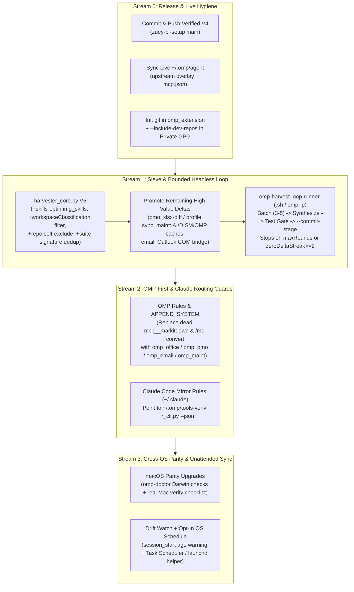

# OMP Ecosystem V5 Architecture Brainstorm

## 1. Problem Statement & Verified Workstation Baseline

Parallel scouting (`4` read-only `scout` subagents across `~/.omp`, `~/.claude`, `zuey-pi-setup`, `plans/omp-consolidation-ledger.json`, and `C:/Users/thant/Projects/omp_extension` — note: Claude Code experimental `ck:team` `TeamCreate` is unavailable in OMP runtime) established two facts:

1. **V4 Foundation Is Implemented & Verified Locally (Uncommitted):**
   - `config/omp/agent/skills/` contains `12` Tier-A suites (`pmo-project-suite`, `office-doc-suite`, `email-intelligence-suite`, `system-maintenance-suite`, `omp-session-harvester`, `pm-ba`, `ak-render`, `windows_fix`, `hlk-*`), `132` Tier-B opt-in skills (`skills-optin/` with `hide: true`), `28` agents, `8` commands, `10` rules, and `9` `managed-skills`.
   - `omp-toolkit-hub.ts` exposes `omp_office`, `omp_pmo`, `omp_email`, `omp_maint`, `omp_harvest` + `/harvest-loop`, `/omp-doctor`, auto-resolving `~/.omp/tools-venv` on Windows/POSIX.
   - `scripts/omp-bootstrap.{sh,ps1}`, `scripts/omp-doctor.py` (`HEALTHY`), `scripts/omp-link-local.py` (`7` active links), `backups/omp-setup-portable.tar.gz` (`2.0 MB`, `1,280` entries), and GPG private backup/restore scripts pass all test suites.
2. **Seven Concrete Residual Gaps Block Full Automation, Auto-Reuse & New-Machine Parity:**

| # | Verified Gap on Disk | Evidence | User Impact |
|---|---|---|---|
| 1 | **V4 Changes Uncommitted on `main`** | `git status -sb`: `26 M + 12 ??`; `origin/main` still at V3 `a86622d` | New Mac/Win cloning `zuey-pi-setup` misses V4 completely |
| 2 | **Rules Route to Dead MCP / Claude Aliases** | `config/omp/agent/rules/file-type-enforcement.md:44-76` mandates non-existent `mcp__markitdown__convert_to_markdown` & `/md-convert`; `skill-domain-routing.md` never mentions `omp_office`/`omp_pmo`/`omp_email`/`omp_maint` | Agents bypass native tools and rewrite Excel/Word/MPP/CleanPC scripts |
| 3 | **Live `~/.omp/agent` Split-Brain** | `~/.omp/agent/mcp.json` absent; `config/omp-upstream/` (`pi-smart-fetch`, `compaction-policy.ts`, `pi-footer-cache-tps.ts`, `APPEND_SYSTEM.md`) absent from live `~/.omp/agent` | `web_fetch`/upstream compaction & `typesafe` MCP fail unless full restore ran |
| 4 | **Queue Unconsumed (`round: 0`) + Self-Scanning Noise** | `promotedHashes: {}`, `771` actionable clusters; top items include unpromoted Excel/MPP diff (`1_tao_plan_tu_excel.ps1`, `2_xuat_excel_tu_plan.ps1`, `3_so_sanh_2_file_excel.ps1`), `06_cleanup_ai_tools.ps1`, `09_cleanup_dism_updates.ps1`, `12_cleanup_omp_sessions.ps1`, `outlook_com.py`; `14` `dev_ops_automation` entries self-scan `zuey-pi-setup` into phantom `skills/dev-ops-automation` | Genuine reusable scripts stay stranded; queue looks 10x larger than reality |
| 5 | **Global Diff False Positives** | `harvester_core.py:945` omits `skills-optin/` from `g_skills` and ignores `workspaceClassification` (`override`/`archive`) | Repeats `19` stale project deltas every scan |
| 6 | **No Headless Batch Loop Driver** | `/harvest-loop` only supports manual single-item `--next` / `--stage` / `--commit-stage` | Multi-session loop cannot run bounded unattended rounds |
| 7 | **`omp_extension` Unbacked & Real macOS Unverified** | `C:/Users/thant/Projects/omp_extension` has no `.git` dir (`fatal: not a git repository`) and is omitted from `omp-private-backup.sh`; Darwin tested only via `OS_OVERRIDE=Darwin` mocks | Moving to a new machine loses extension source history/tests; real Apple Silicon hardware untested |

---

## 2. Systematic Problem-Solving Analysis (`ck:problem-solving`)

1. **Simplification Cascade — Routing & Sieve Before Automation:**
   - Rewriting `file-type-enforcement.md` + `skill-domain-routing.md` + `APPEND_SYSTEM.md` **once** fixes tool discovery for both OMP (`omp_*` tools) and Claude Code (`~/.omp/tools-venv` + `*_cli.py --json`), eliminating ad-hoc script regeneration at the source.
   - Fixing `harvester_core.py`'s self-scan exclusion + `skills-optin` check + suite-capability tagger **before** running a headless batch loop eliminates ~90% of false-positive queue entries before burning LLM tokens.
2. **Meta-Pattern Recognition — Genuine Missing Capabilities Still in Queue:**
   - **PMO Excel <-> MS Project Diff & Dynamic Profile Sync (`pmo-project-suite`):** `pmo_cli.py` already has `excel2xml`, `xlsx2msp`, `mpp2xml`, `sprint-export`, **but lacks 2-file Excel comparison/reconciliation (`3_so_sanh_2_file_excel.ps1` -> pure-Python `xlsx-diff`) and JSON column-profile builder parity** (`1_tao_plan_tu_excel.ps1`, `2_xuat_excel_tu_plan.ps1`).
   - **Maintenance Extended Targets (`system-maintenance-suite`):** `06_cleanup_ai_tools.ps1`, `09_cleanup_dism_updates.ps1`, `12_cleanup_omp_sessions.ps1`, `check_c.ps1`, `scan_stale.ps1` should be audited 1:1 against `cleaner_dispatcher.py` — keeping anything net-new (`--cmd dism-check`, `omp-cache-prune`, system-file footprint check) and marking duplicates `merged_into`.
   - **Email COM & Pipeline Bridge (`email-intelligence-suite`):** Audit `outlook_com.py` / `Run-Pipeline.ps1` — promote cross-OS abstractions or PowerShell Windows-only hooks clearly gated by OS, marking already-covered parser logic `merged_into`.
   - **DevOps / Harness Utilities (`dev_ops_automation`):** Exclude `zuey-pi-setup` source files from harvester scan and convert `dev_ops_automation` phantom ledger entry into either `merged_into` (meta-tooling lives in `scripts/`) or clean classification.
3. **Inversion Exercise — "Zero-Guesswork & Fresh-Machine Survival":**
   - Invert *"agents write scripts flexibly"*: **forbid ad-hoc `.py`/`.ps1` generation for Office, PMO, Email, and System Cleanup** unless `omp_*` / `*_cli.py` explicitly lacks the feature (and if missing, extend the canonical suite + test it instead of leaving a one-off script in `/tmp`).
   - Invert *"C:/Users/thant/Projects/omp_extension always exists"*: ensure `omp_extension` has its own git repo + optional `--include-dev-repos` archive in `omp-private-backup.sh` so a clean laptop restores **live editable extension source**, not only the read-only `config/omp/agent/extensions/typesafe-planner/` snapshot.
4. **Scale Game (`771` -> `~30–60` Net Utilities -> `<=5` Bounded Rounds):**
   - Sieving first reduces multi-round loop scope from ~150 single-item rounds to **3–6 domain-batched rounds**, bounded by `maxRounds`, `batchSize`, mandatory `pytest`/`bun test`/`omp-doctor --strict` gates, and `zeroDeltaStreak >= 2`.

---

## 3. Evaluated Architectural Approaches (`ck:brainstorm`)

### A. Cross-Client Tool Reuse (OMP + Claude Code)

| Option | Design | Pros | Cons | Verdict |
|---|---|---|---|---|
| **1. Rules + Shared CLI (`rules_and_shared_cli`)** | Keep `omp-toolkit-hub` native tools for OMP; update `rules/` (`file-type-enforcement.md`, `skill-domain-routing.md`, `APPEND_SYSTEM.md`) for OMP-first routing AND update mirrored `~/.claude` rules/skills to call `~/.omp/tools-venv` + `*_cli.py --json` directly | Zero MCP daemon cold-start; zero duplicate business logic; respects `hide: true` token budget | Claude Code executes via Bash CLI rather than typed MCP schema | **CHOSEN** |
| **2. Shared Thin Stdio MCP (`omp-suites-mcp`)** | Expose 4 Python suites via stdio MCP in `mcp.json` + `~/.claude.json` | Identical tool schemas in OMP & Claude Code | Process startup latency, duplicate schema maintenance alongside `omp-toolkit-hub.ts` | Deferred (revisit only if Claude Code CLI adoption slips) |

### B. Multi-Round Harvester Loop

| Option | Design | Pros | Cons | Verdict |
|---|---|---|---|---|
| **1. Pre-Triage Sieve + Bounded Headless Batch Loop (`sieve_then_batch_loop`)** | Fix `harvester_core.py` filters (`skills-optin`, `workspaceClassification`, repo self-exclude, suite signature matcher), then run bounded headless `omp -p` batches (`3–5` items/round, strict test + `omp-doctor` gate, stop on `zeroDeltaStreak >= 2`) | High signal-to-noise; low token spend; resumable across compaction/sessions via `promotionQueue` + `loopMeta` | Requires pre-filtering update before running batches | **CHOSEN** |
| **2. Raw Queue Consumer Loop** | Iterate raw `771`-item queue 1-by-1 via `/harvest-loop` | Zero harvester filter changes | Wastes rounds on self-indexed repo files & already-merged utilities | Rejected |

### C. Release Hygiene, Live Sync & External Source Backup

| Option | Design | Pros | Cons | Verdict |
|---|---|---|---|---|
| **1. Ship V4 + Sync Live + `omp_extension` Coverage (`commit_v4_plus_sync_and_ext_backup`)** | Commit/push verified V4 baseline; apply upstream overlay + `mcp.json` to live `~/.omp/agent`; init git + add opt-in `--include-dev-repos` in `omp-private-backup.sh` for `omp_extension`; add drift staleness alert + opt-in scheduler helpers | Eliminates uncommitted release risk, live split-brain, and unbacked `omp_extension` source | One extra prerequisite commit step before V5 work | **CHOSEN** |
| **2. Bundle Everything Into One Giant V5 Commit** | Defer V4 commit; keep `omp_extension` manual | Fewer commits | High blast radius; new machine stays stuck on V3 until V5 finishes | Rejected |

---

## 4. Multi-Persona Pre-Analysis (`ck:predict` — 5 Independent Personas)

**Verdict: `GO WITH STRICT GATES`** (`CAUTION` on headless batch auto-promotion and real macOS hardware edge cases)

| Topic | Architect | Security | Performance | UX | Devil's Advocate | Consensus Resolution |
|---|---|---|---|---|---|---|
| **OMP-First Rule Enforcement** | Single routing matrix in `rules/` prevents dual logic | Never instruct agents to pass unquoted paths or disable XXE/CWE-1236 guards | Replaces `markitdown` MCP retries with direct `omp_*` dispatch | Users ask in plain Vietnamese/English and get `omp_office`/`omp_pmo` automatically | Rules alone can still be ignored if `file-type-enforcement.md` still cites `/md-convert` | **Delete dead `mcp__markitdown` / `/md-convert` refs** from `file-type-enforcement.md`; replace cleanly with `omp_office`/`omp_pmo`/`omp_email` + Claude CLI fallback |
| **Harvester Sieve & Headless `omp -p`** | Separate deterministic sieve (`harvester_core.py`) from LLM synthesis (`omp-harvest-loop-runner`) | Sanitize extracted snippet (`_PRIV_PAT`, `ABS_LEFT`) *before* feeding to headless `omp -p` | Filtering self-scans + `skills-optin` cuts scan/queue payload by ~85–90% | `loop-state` shows clear round summary (`promoted`, `merged_into`, `deferred`) | Headless loop committing unreviewed code could break existing suites | **Mandatory gate per batch:** `pytest`/unittest + `bun test` + `omp-doctor --strict`; fail -> rollback `staged` & stop loop |
| **`omp_extension` Backup** | Keep `zuey-pi-setup` clean of external dev repos | Never embed git credentials or local `.env` from `omp_extension` inside `zuey-pi-setup` | Archive excludes `node_modules` / `.git` objects unless `--include-dev-repos` requested | Restores live editable `C:/Users/thant/Projects/omp_extension` (or `~/Projects/omp_extension`) on new PC | Copying snapshot back as editable repo loses history | **Init `git` inside `omp_extension`** + add `--include-dev-repos` (`~/Projects/omp_extension`) to `omp-private-{backup,restore}.sh` |
| **Unattended Sync & macOS Parity** | Opt-in OS scheduler (`launchd` plist / Task Scheduler `.ps1`) wrapping `omp-bootstrap.sh` | Never auto-commit/push secrets; auto-sync runs backup scan + reminder or private local GPG only when passphrase configured non-interactively | Incremental watermarks skip unchanged files (`O(delta)`) | Zero-nag default; `session_start` warns only when snapshot drift > threshold | Silent background `git push` could ship broken WIP | **Scheduled local sync / drift check only** (harvest + drift notice + optional local tarball/GPG if explicitly enabled); explicit user confirmation or clean green gate before push |

---

## 5. Edge-Case & Failure-Mode Matrix (`ck:scenario`)

*(Evaluated relevant dimensions: Environment Win/Mac, Integration OMP+Claude, State Transitions, Error Cascades, Scale, Data Integrity, Timing, Compliance/Privacy.)*

| # | Dimension | Scenario | Severity | Required Mitigation |
|---|---|---|---|---|
| 1 | **Integration (Rules Drift)** | `omp-setup-backup.sh` mirrors live `~/.omp/agent/rules/`, overwriting repo rule edits if live rules weren't synced first. | **High** | Update canonical rules in `config/omp/agent/rules/` -> sync to `~/.omp/agent/rules/` & `~/.claude/rules/` BEFORE `omp-setup-backup.sh` (or add `omp-doctor` drift check comparing repo vs live rules). |
| 2 | **State Transitions (Headless Loop)** | Headless `omp -p` round crashes after editing `pmo-project-suite` before tests run or `--commit-stage` executes. | **Critical** | Runner takes git stash/checkpoint or checks clean baseline before round, runs `--stage <hash>`, validates suite `unittest` + `bun test` + `omp-doctor`, and ONLY then runs `--commit-stage`; failure leaves `staged` orphan surfaced on next `session_start` / `--next`. |
| 3 | **Data Integrity (Harvester Self-Exclude)** | Excluding `zuey-pi-setup` from `harvester_core.py` accidentally drops genuine skills inside `config/omp/agent/skills/` from cross-session dedup hash matching. | **High** | Keep `config/omp/agent/skills/` indexed as **reference-only (`already_promoted`)** signatures rather than deleting from hash table, while excluding `scripts/`, `tests/`, `plans/` from `promotionQueue` candidates. |
| 4 | **Environment (macOS Real Hardware)** | Homebrew `python3` lacks `tk`/`mpxj`, `bun` sits in `~/.bun/bin`, Gatekeeper blocks unsigned binaries, or Apple Silicon `pinentry-mac` isn't installed yet. | **High** | Enhance `omp-doctor.py` Darwin checks (detect Homebrew Python vs Xcode CLT stub, Java/`mpxj` presence for `.mpp`, `pinentry-mac` existence, `~/.bun/bin` PATH) and provide a crisp real-Mac Day-1 checklist + interactive verification step. |
| 5 | **Integration (Claude Code Parity)** | User opens `claude` (Claude Code) on a newly restored Mac where `omp-setup-restore.sh` populated `~/.omp/` but `~/.claude/` wasn't restored from private GPG. | **High** | Document & wire optional `--link-claude` helper in `omp-bootstrap.sh` (mirrors/links shared `*-suite` skills + `file-type-enforcement.md` into `~/.claude/` when `~/.claude` exists without full private GPG restore). |
| 6 | **Compliance / Privacy** | `promotionQueue` batch extracts `1_tao_plan_tu_excel.ps1` or `outlook_com.py` containing internal server/share paths or bank/client field names. | **Critical** | Run `_PRIV_PAT` + `privateKeywords` scrubber + `ABS_LEFT` path check automatically during `--extract` and again inside `omp-setup-backup.sh` pre-tarball gate. |
| 7 | **Timing / Concurrency** | Scheduled background harvest runs while an interactive OMP session writes `omp-harvester-cache.json` or `history.db` WAL. | **Medium** | Use advisory lockfile (`~/.omp/harvester.lock`), `_atomic_write_json`, `WinError 32` retry on `.jsonl`, and read-only SQLite URI (`?mode=ro`) / `VACUUM INTO`. |

---

## 6. Recommended V5 Architecture

### Concrete V5 Deliverables by Stream

1. **Stream 0 — Baseline Ship & Split-Brain Fix:**
   - Commit & push verified V4 changes on `main` (`config/omp/`, `scripts/`, `tests/`, `docs/`, `plans/`, `backups/omp-setup-portable.tar.gz`) + export fresh GPG `--all` backup.
   - Sync `config/omp-upstream/` + initialize `~/.omp/agent/mcp.json` on the live Windows workstation via `omp-bootstrap.sh` / `omp-setup-restore.sh` (without overwriting customized live keys).
   - Initialize `git` in `C:/Users/thant/Projects/omp_extension` and add optional `--include-dev-repos` flag to `omp-private-{backup,restore}.sh`.
2. **Stream 1 — Harvester Signal Sieve & Headless Multi-Round Runner:**
   - Update `harvester_core.py`: include `skills-optin` in `g_skills`, suppress already-classified `override`/`archive` dirs in `scan_global_diff` (unless `--all-deltas`), tag `zuey-pi-setup` own scripts as non-queue reference signatures (eliminating phantom `dev_ops_automation` self-queueing), and mark already-covered utilities via capability/AST-signature matching (`--auto-triage-known`).
   - Promote genuinely missing high-value queue items into the 4 suites: notably **2-way Excel comparison & dynamic JSON column-profile builder (`xlsx-diff`)** in `pmo-project-suite`, net-new cleanup checks (`AI tools`, `DISM/component check`, `OMP session/WAL pruner`) in `system-maintenance-suite`, and clean PowerShell COM fallback wiring in `email-intelligence-suite`.
   - Add bounded unattended batch runner (`scripts/omp-harvest-loop-runner.sh` + `/harvest-loop auto` instructions) orchestrating `omp -p` batches (`--max-rounds`, `--batch-size`, mandatory `unittest` + `bun test` + `omp-doctor --strict`, `zeroDeltaStreak` stop).
3. **Stream 2 — Hard Routing Guards (OMP + Claude Code):**
   - Rewrite `config/omp/agent/rules/file-type-enforcement.md`, `skill-domain-routing.md`, `skill-workflow-routing.md`, and `config/omp-upstream/agent/APPEND_SYSTEM.md` so both OMP and Claude Code default to `omp_office` / `omp_pmo` / `omp_email` / `omp_maint` (or `~/.omp/tools-venv` `*_cli.py --json` for Claude Code) **before** creating any custom script, removing broken `mcp__markitdown` / `/md-convert` instructions.
   - Add `--link-claude` option in `omp-bootstrap.sh` to keep `~/.claude/rules/` & suite skill stubs synced cleanly when Claude Code is installed alongside OMP.
4. **Stream 3 — Real macOS Parity & Low-Friction Sync Automation:**
   - Extend `omp-doctor.py` with macOS runtime diagnostics (`pinentry-mac`, `mpxj`/Java presence for `.mpp`, Homebrew vs CLT Python, `.omp` vs repo rule drift check) and Windows/macOS backup staleness age check (`>7d` warning).
   - Surface staleness warning once on `session_start` inside `omp-toolkit-hub.ts` and provide opt-in `scripts/omp-schedule-sync.{sh,ps1}` installers (`launchd` plist on macOS, Task Scheduler task on Windows) running non-destructive incremental harvest + drift report + optional private local backup.

---

## 7. Success Metrics & Validation Criteria

1. **Zero Dead Tool Routing:** `grep` across `config/omp/agent/rules/` shows `0` references to unconfigured `mcp__markitdown` or `/md-convert`; both `file-type-enforcement.md` and `skill-domain-routing.md` route directly to `omp_*` tools and `~/.omp/tools-venv` CLIs.
2. **Harvester Signal Compression:** Actionable `promotionQueue` drops from `771` noisy/self-scanned clusters to verified net-missing items; `scan_global_diff` reports `0` false-positive deltas for classified `override`/`archive` or `skills-optin` directories; `round >= 1` and `promotedHashes` actively records promoted clusters.
3. **Automated Loop Safety:** Headless batch runner test executes a bounded 1–2 round smoke fixture, passes `pytest`/`unittest` + `bun test` + `omp-doctor --strict`, and cleanly rolls back `staged` entries on simulated test failure.
4. **Full Cross-OS & External Repo Coverage:** `omp-private-backup.sh --all --include-dev-repos` + restore test restores `omp_extension` source, `mcp.json`, `~/.omp`, and `~/.claude` parity links cleanly on Windows and simulated Darwin, plus documented smoke checklist for first real macOS run.

---

## 8. Next Steps

1. Confirm whether to **commit & push V4 baseline now** and **generate the detailed V5 implementation plan** (`/ck:plan`) from this brainstorm blueprint.
